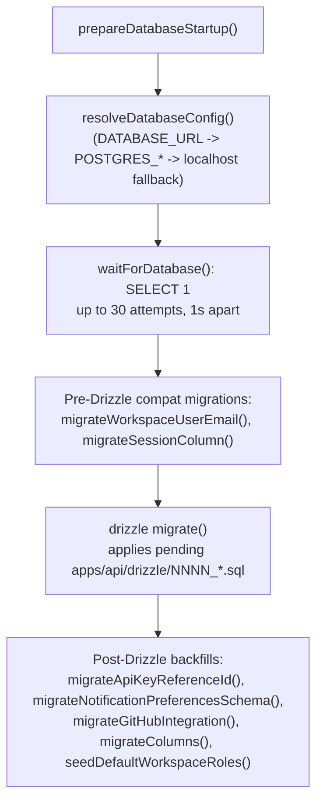

# apps/api/database

Active contributors: Andrej Acevski, Tin Sever

`apps/api` talks to PostgreSQL through Drizzle ORM. The schema is defined once in `apps/api/src/database/schema.ts`, relations in `apps/api/src/database/relations.ts`, and a single lazy Drizzle instance is shared by every controller, middleware, and the Better Auth adapter. Schema changes are shipped as generated migrations in `apps/api/drizzle/`, and a handful of one-off startup backfills repair existing installations without generating new migration noise.

## Purpose

All durable state lives here: workspaces, projects, tasks, and every supporting table (columns, labels, custom fields, comments, time entries, activity, relations, external links, assets, notifications), plus Better Auth's tables (users, sessions, accounts, verification, API keys, device codes) and the operational tables (billing, jobs, MCP OAuth state). Because the web app's realtime cache mirrors what the API writes, the schema is also the contract for what can appear in events and WebSocket payloads.

## Directory layout

```text
apps/api/src/database/
├── index.ts                    # pool + lazy Drizzle instance, exported schema bundle
├── schema.ts                  # all pgTable definitions (plus auth-compatible aliases)
├── relations.ts               # Drizzle relations between tables
├── resolve-database-url.ts    # DATABASE_URL resolution (explicit / derived / fallback)
├── prepare-database-startup.ts# ordered startup: config, readiness, migrations
└── wait-for-database.ts       # retrying SELECT 1 readiness probe

apps/api/drizzle/
├── <NNNN>_*.sql               # generated migrations (drizzle-kit)
└── meta/                      # drizzle-kit migration journal
```

## Key abstractions

| Abstraction | Location | Role |
| --- | --- | --- |
| `schema` bundle | `apps/api/src/database/index.ts` | Exports every table and relation object; consumed by `drizzle()`, the Better Auth adapter, and controllers that import `schema` directly. |
| `db` | `apps/api/src/database/index.ts` | The default Drizzle instance — a `Proxy` that lazily constructs the pool and binds query methods, so importing it never connects before it is needed. |
| `getDatabasePool()` / `getDatabase()` | `apps/api/src/database/index.ts` | Explicit accessors used by startup code (readiness check, migrations) that must force a connection. |
| `resolveDatabaseConfig()` | `apps/api/src/database/resolve-database-url.ts` | Picks the connection string: `DATABASE_URL`, else derived from `POSTGRES_*` variables, else `postgresql://localhost:5432/kaneo`. |
| `migrate()` (drizzle-orm) | called from `apps/api/src/index.ts` | Applies pending SQL migrations from `apps/api/drizzle/` at startup. |
| `migrate-*` utilities | `apps/api/src/utils/*.ts`, `apps/api/src/plugins/github/migration.ts`, `apps/api/src/migrations/column-migration.ts` | Idempotent, one-off startup backfills for existing installations. |

## How it works

### Schema groups

`apps/api/src/database/schema.ts` defines roughly forty tables. They group as:

| Group | Tables | Notes |
| --- | --- | --- |
| Identity / auth (Better Auth) | `user`, `session`, `account`, `verification`, `apikey`, `device_code` | Better Auth maps these through the Drizzle adapter; the file also exports auth-compatible aliases (`user`, `session`, `account`, `verification`, `workspace`, `workspace_member`, `invitation`, `organizationRole`, `team`, `teamMember`, `apikey`, `deviceCode`). |
| Workspace & membership | `workspace`, `workspace_member`, `workspace_role`, `team`, `team_member`, `invitation`, `workspace_billing`, `trial_grant`, `billing_event`, `billing_reminder_sent` | Membership role + the per-workspace role permission rows that dynamic access control reads. |
| Project & board | `project`, `column`, `workflow_rule`, `github_integration`, `integration` | Columns carry position and `isFinal`; workflow rules reference an integration type + event type + target column. |
| Task & task content | `task`, `label`, `task_relation`, `external_link`, `comment`, `time_entry`, `activity`, `asset`, `custom_field_definition`, `custom_field_value`, `task_reminder_sent` | Task numbers are unique per project (`task_project_number_unique`); labels are either workspace-level or task-level; activity records carry optional external-source dedup columns. |
| User & notifications | `user_avatar`, `notification`, `user_notification_preference`, `user_notification_workspace_rule`, `user_notification_workspace_project` | Preferences store delivery channels (email/ntfy/gotify/webhook); the workspace rule + project tables scope notifications to projects. |
| Operational | `job_lease`, `mcp_oauth_state` | `job_lease` guards scheduled jobs across instances; `mcp_oauth_state` backs the MCP OAuth store. |

IDs are CUIDs generated with `createId()` via `$defaultFn`. `apps/api/src/database/relations.ts` centralizes relations so queries can use `db.query.<table>.findMany()` with eager-loaded relations; notable cases are the named `sourceTask`/`targetTask` relations on `task_relation` and the composite foreign keys from `user_notification_workspace_project` into both `user_notification_workspace_rule` and `project`.

### Connection resolution

`apps/api/src/database/resolve-database-url.ts` chooses the connection string in order:

1. `DATABASE_URL` — explicit, takes precedence.
2. Derived from `POSTGRES_USER` / `POSTGRES_PASSWORD` / `POSTGRES_HOST` / `POSTGRES_PORT` / `POSTGRES_DB` — the Docker Compose / Railway shape; requires `POSTGRES_PASSWORD`, and any of the `POSTGRES_*` variables must be present to activate this path.
3. `postgresql://localhost:5432/kaneo` — local development fallback.

The pool (in `apps/api/src/database/index.ts`) uses `max: 10` connections, a 5-second connect timeout, and a 30-second idle timeout. Startup reports which source it connected through, which makes a misconfigured compose deployment obvious in the boot log.

### Migration workflow

Schema changes follow the repo convention: edit `apps/api/src/database/schema.ts` (and `relations.ts`), then generate:

```bash
pnpm --filter @kaneo/api db:generate
```

That writes a numbered SQL file into `apps/api/drizzle/` via drizzle-kit. Inspect the generated SQL before committing it, and include it with the schema change. `pnpm --filter @kaneo/api db:migrate` applies migrations manually for development; `db:studio` opens the drizzle-kit UI.

At server startup, `runStartupTasks()` in `apps/api/src/index.ts` runs the full sequence through `apps/api/src/database/prepare-database-startup.ts`:



If configuration, readiness, or migration fails, startup logs the failing step and the process exits — the API never serves against a schema it cannot account for.

### The one-off startup backfills

The `migrate-*` functions in `apps/api/src/utils/` (plus `apps/api/src/migrations/column-migration.ts` and `apps/api/src/plugins/github/migration.ts`) are a deliberate pattern distinct from generated migrations. They are **idempotent compat/backfill migrations for existing installations**: each one checks `information_schema` for the table or column it expects, applies only what is missing, and is safe to re-run on every boot. Examples, without exhaustively covering every one:

- `apps/api/src/utils/migrate-workspace-user-email.ts` — converts legacy `workspace_member.user_email` rows to `user_id`, drops orphaned rows, and removes the old column.
- `apps/api/src/utils/migrate-session-column.ts` — renames `session.active_workspace_id` to `active_organization_id` and adds `invitation.created_at` with a backfilled default.
- `apps/api/src/utils/migrate-apikey-reference-id.ts` — aligns the `apikey` table with Better Auth expectations (`reference_id` populated from `user_id`, `config_id` defaulted, `user_id` made nullable, supporting indexes created).
- `apps/api/src/utils/migrate-notification-preferences-schema.ts` — repairs notification-preference tables that drifted during an upgrade by creating tables and columns with `IF NOT EXISTS` and re-adding constraints.
- `apps/api/src/utils/seed-default-workspace-roles.ts` — inserts the editable default roles (`viewer`/`member`/`admin`) for workspaces that predate dynamic access control, batched to stay under Postgres' bind-parameter limit.
- `apps/api/src/migrations/column-migration.ts` — seeds default columns for legacy projects and derives workflow rules from old GitHub/Gitea integration configs.

The split matters for ordering: the pre-Drizzle pair (`migrateWorkspaceUserEmail`, `migrateSessionColumn`) runs **before** `migrate()` so column renames/drops do not collide with the generated migration history, while the backfills run **after** because they need the tables Drizzle just created. Use this pattern only for compat/backfill work; ordinary schema evolution belongs in `db:generate` migrations.

## Integration points

- **Drizzle schema** is the source of truth for every query in the API; controllers import `schema` and `db` from `apps/api/src/database`.
- **Better Auth** maps its models onto the schema through the Drizzle adapter in `apps/api/src/auth.ts` (see [apps/api/auth.md](auth.md)).
- **Events and realtime**: mutation data written here is what controllers pass to `publishEvent()` and what WebSocket payloads carry; see [Realtime](../../features/realtime.md).
- **MCP OAuth state** and scheduled-job leases are persisted here (`mcp_oauth_state`, `job_lease`); see [MCP](../../packages/mcp.md).
- **The web app** reads this data through the API; see [apps/web/index.md](../web/index.md). For a table-by-table breakdown, see [Data models](../../reference/data-models.md).

## Entry points for modification

- **Add or change a table**: edit `apps/api/src/database/schema.ts`, update relations in `apps/api/src/database/relations.ts`, then run `pnpm --filter @kaneo/api db:generate`, inspect the SQL, and include it. Update the Better Auth schema mapping in `apps/api/src/auth.ts` if the table is auth-managed.
- **Change an existing table's columns for a running installation**: prefer a generated migration; add a one-off `migrate-*` backfill only for idempotent compat fixes that must also apply to installations with dirty migration state.
- **Change connection behavior**: edit `apps/api/src/database/index.ts` (pool) or `apps/api/src/database/resolve-database-url.ts` (resolution order).
- **Change startup ordering**: edit `apps/api/src/index.ts` `runStartupTasks()` and `apps/api/src/database/prepare-database-startup.ts`.

## Key source files

| File | What it contains |
| --- | --- |
| `apps/api/src/database/schema.ts` | All `pgTable` definitions plus Better Auth-compatible aliases |
| `apps/api/src/database/relations.ts` | Drizzle relations, including named `task_relation` relations and composite FKs |
| `apps/api/src/database/index.ts` | Lazy pool and Drizzle instance, exported `schema` bundle |
| `apps/api/src/database/resolve-database-url.ts` | `DATABASE_URL` → `POSTGRES_*` → localhost fallback resolution |
| `apps/api/src/database/prepare-database-startup.ts` | Ordered startup: config, readiness, migration runner |
| `apps/api/src/database/wait-for-database.ts` | Retrying readiness probe |
| `apps/api/src/utils/migrate-workspace-user-email.ts` | Pre-Drizzle legacy `user_email` → `user_id` conversion |
| `apps/api/src/utils/migrate-session-column.ts` | Pre-Drizzle session/invitation column alignment |
| `apps/api/src/utils/migrate-apikey-reference-id.ts` | Post-Drizzle `apikey` alignment with Better Auth |
| `apps/api/src/utils/migrate-notification-preferences-schema.ts` | Post-Drizzle notification-preference repair |
| `apps/api/src/utils/seed-default-workspace-roles.ts` | Post-Drizzle default-role backfill |

## Related pages

- [apps/api/index.md](index.md) — the startup sequence that drives these migrations
- [apps/api/auth.md](auth.md) — how Better Auth consumes this schema
- [Data models](../../reference/data-models.md) — table-by-table data reference
- [Patterns and conventions](../../how-to-contribute/patterns-and-conventions.md) — the module conventions around database access
