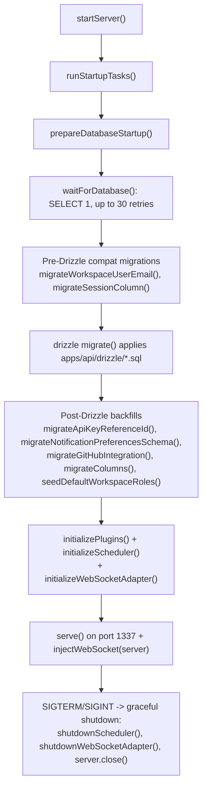
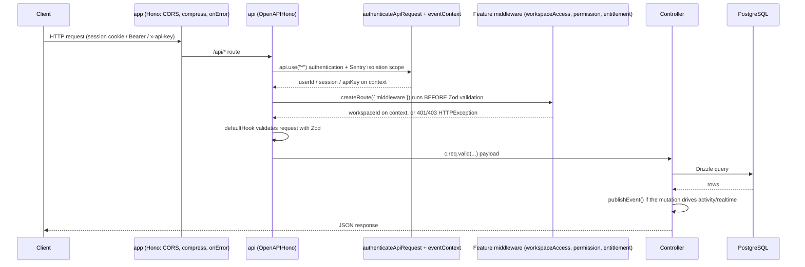

# apps/api

Active contributors: Andrej Acevski, Tin Sever

`apps/api` is the Kaneo API server. It is a Hono application on Node that owns every REST route, the WebSocket endpoint, authentication, event publication, integrations, the MCP HTTP endpoint, and the scheduled jobs. Everything the web app calls goes through this package, and `packages/libs` generates the web app's typed client from its route types, so a change here is a contract change for the frontend.

## Purpose

`apps/api/src/index.ts` is the composition root. It builds the Hono app, mounts twenty-seven feature routers plus the MCP router, wires the WebSocket upgrade handlers, runs startup migrations, and then binds a port. The request path through a single route is: CORS and compression middleware, app-wide authentication, per-route workspace-access middleware, Zod validation, the controller, and a Zod-validated JSON response — with `publishEvent()` called from controllers when a mutation matters for activity, notifications, integrations, or realtime updates.

## Directory layout

```text
apps/api/src/
├── index.ts                  # createApp(), runStartupTasks(), startServer()
├── openapi.ts                # apiRouter() factory, defaultHook, response helpers
├── database/                 # Drizzle schema, relations, connection resolution
├── events/                   # publishEvent() / subscribeToEvent() event bus
├── utils/                    # authenticateApiRequest, requireWorkspacePermission, migrations
├── <feature>/                # one module per feature (task, project, workspace, ...)
├── mcp/                      # MCP HTTP endpoint + its OAuth authorization server
├── oauth/                    # id-token endpoint for the custom OAuth provider
├── integrations/             # shared integration middleware, schemas, responses (project scoping)
├── plugins/                  # per-provider integration plugins + registry
├── ws/                       # WebSocket adapter + Redis broadcast
├── redis/                    # optional Redis client
├── scheduler/                # cron jobs (reminders, seat reconciliation)
├── billing/                  # billing, trials, entitlements
├── storage/                  # S3-compatible object storage for assets
└── migrations/               # one-off column/workflow-rule backfill
```

Each feature module follows the shape described in [Patterns and conventions](../../how-to-contribute/patterns-and-conventions.md): `index.ts` (routes), `schema.ts` (Zod request), `response.ts` (Zod response with `.openapi("Name")`), and `controllers/<verb-noun>.ts` (domain logic).

## Key abstractions

| Abstraction | Location | Role |
| --- | --- | --- |
| `createApp()` | `apps/api/src/index.ts` | Builds the top-level `Hono` app (CORS, compression, error handling) and the `OpenAPIHono` `api` router; returns both plus `injectWebSocket`. |
| `apiRouter()` | `apps/api/src/openapi.ts` | Factory for `OpenAPIHono` instances with a `defaultHook` that converts the first Zod issue into an `HTTPException(400, ...)`. |
| `createRoute`, `jsonResponse`, `errorResponse` | `apps/api/src/openapi.ts` | Route and response helpers shared by every feature. |
| `AppType` | `apps/api/src/index.ts` | Union of all feature router types; `packages/libs` builds the typed client from it. |
| `authenticateApiRequest` | `apps/api/src/utils/authenticate-api-request.ts` | App-wide middleware that resolves session cookies, bearer tokens, or API keys and sets `userId`/`user`/`session`/`apiKey` on the Hono context. |
| `workspaceAccess` | `apps/api/src/utils/workspace-access-middleware.ts` | Resolves a `workspaceId` from a query/body/param or by looking up the parent row of a resource, then validates membership. |
| `requireWorkspacePermission` | `apps/api/src/utils/require-workspace-permission.ts` | Checks the permission vocabulary from `@kaneo/permissions` against the member's role. |
| `publishEvent` / `subscribeToEvent` | `apps/api/src/events/index.ts` | In-process event bus that activity, notifications, integrations, and WebSocket delivery all subscribe to. |
| `runStartupTasks` | `apps/api/src/index.ts` | Ordered startup work: wait for the database, run migrations, initialize plugins, scheduler, and WebSocket adapter. |

## How it works

### Startup sequence

The server starts only when `apps/api/src/index.ts` is the entry module (`isMainModule` check). `startServer()` runs `runStartupTasks()` first and exits with code 1 if anything in that sequence fails, then binds the HTTP server on port 1337 (the default in `apps/api/src/index.ts`) and calls `injectWebSocket()` so the Hono app's upgrade routes work against the real `@hono/node-server` server.



The ordering is deliberate. `migrateWorkspaceUserEmail()` and `migrateSessionColumn()` (`apps/api/src/utils/migrate-workspace-user-email.ts`, `apps/api/src/utils/migrate-session-column.ts`) run **before** Drizzle's `migrate()` because they rename/drop columns (`user_email` → `user_id` on `workspace_member`, `active_workspace_id` → `active_organization_id` on `session`) that would otherwise collide with the generated migrations. The backfills after Drizzle (see [apps/api/database.md](database.md)) repair existing installations idempotently, and `seedDefaultWorkspaceRoles()` guarantees every workspace has its editable default roles.

### Request lifecycle

The top-level `app` (a plain `Hono`) applies `cors` and `compress()` globally and handles errors via `app.onError`: expected `HTTPException`s return their response (those at 500+ are also captured by Sentry), everything else is logged to Sentry and answered with a generic 500. The `/api` router is mounted with `app.route("/api", api)`, so every API path is `/api/<route>`.



Key ordering facts:

- Route middleware declared in `createRoute({ middleware })` runs **before** request validation, so it must read the raw request (`c.req.param()`, `c.req.query()`, `c.req.json()`), not `c.req.valid()` — see `apps/api/src/openapi.ts`.
- The app-wide `api.use("*", ...)` middleware in `apps/api/src/index.ts` authenticates every `/api/*` route except `/api/mcp`, `/api/.well-known/`, and `/api/billing/webhook`, then wraps the handler in `eventContext.run({ initiatorId })` so `publishEvent()` can attach the acting user (or `userId:windowId` for multi-window sessions) to every event it emits.
- The `defaultHook` from `apps/api/src/openapi.ts` turns the first Zod issue into `HTTPException(400, "field: message")`.

### Route mounting

`createApp()` registers routes directly on the `api` router (health, instance status, public project, invitation details, session, assets, avatars, device authorization, OpenAPI document, `/auth/*` passthrough to Better Auth, and MCP), then mounts the feature routers with `api.route("/<prefix>", router)`:

| Prefix | Module |
| --- | --- |
| `/config` | `apps/api/src/config/` |
| `/oauth` | `apps/api/src/oauth/` |
| `/project` | `apps/api/src/project/` |
| `/task` | `apps/api/src/task/` |
| `/column` | `apps/api/src/column/` |
| `/activity` | `apps/api/src/activity/` |
| `/comment` | `apps/api/src/comment/` |
| `/time-entry` | `apps/api/src/time-entry/` |
| `/label` | `apps/api/src/label/` |
| `/notification` | `apps/api/src/notification/` |
| `/notification-preferences` | `apps/api/src/notification-preferences/` |
| `/search` | `apps/api/src/search/` |
| `/task-relation` | `apps/api/src/task-relation/` |
| `/external-link` | `apps/api/src/external-link/` |
| `/workflow-rule` | `apps/api/src/workflow-rule/` |
| `/invitation` | `apps/api/src/invitation/` |
| `/workspace` | `apps/api/src/workspace/` |
| `/custom-field` | `apps/api/src/custom-field/` |
| `/user` | `apps/api/src/user/` |
| `/billing` | `apps/api/src/billing/` |
| `/github-integration`, `/gitea-integration`, `/slack-integration`, `/discord-integration`, `/mattermost-integration`, `/telegram-integration`, `/generic-webhook-integration` | per-provider integration modules |
| `/mcp` (root-mounted) | `apps/api/src/mcp/` |

Inbound webhook routes (GitHub `/github-integration/webhook`, Gitea `/gitea-integration/webhook/:integrationId`) are registered directly on `api` so external services can call them without authentication; they are described in [Integrations](../../features/integrations.md).

### OpenAPI document

`GET /api/openapi` returns the OpenAPI 3.1 document generated from every `createRoute()` definition, with `bearerAuth` registered as the single security scheme. Because every authenticated route sits behind the same app-wide middleware, the endpoint injects a shared `401` response onto all operations that did not opt out with `security: []`. The committed artifact `apps/docs/openapi.json` is regenerated with `pnpm openapi:check:fix` whenever a route, request schema, or response schema changes; CI fails on drift.

### Assets and avatars

- `GET /api/asset/{id}` streams a stored asset. It looks up the asset, calls `authorizeAssetAccess` (public-project assets skip credentials, otherwise a session/API-key check plus workspace membership), then returns the object with a computed `Content-Disposition` — safe inline types (image/*) are served inline, everything else as an attachment, with the filename sanitized in `buildContentDisposition()`.
- `GET /api/user/avatar/{id}` serves user avatars with an ETag based on the avatar id and immutable caching, so replacing an avatar changes the URL and invalidates caches.

## Integration points

- **Realtime / WebSockets**: `/api/ws/user` and `/api/ws/:projectId` upgrade routes live in `apps/api/src/index.ts`; the event-to-WebSocket path is documented in [Realtime](../../features/realtime.md).
- **Integrations**: the `apps/api/src/plugins/` registry and per-provider modules are covered in [Integrations](../../features/integrations.md).
- **Billing**: `apps/api/src/billing/` (trials, subscriptions, entitlements) is covered in [Billing](../../features/billing.md).
- **MCP**: the OAuth authorization server and tool endpoint in `apps/api/src/mcp/` are covered in [MCP](../../packages/mcp.md) (also summarized in [apps/api/auth.md](auth.md) from the authentication angle).
- **Scheduler**: `apps/api/src/scheduler/` runs due-date reminders, trial reminders, and seat reconciliation; see [Notifications](../../features/notifications.md) and [Billing](../../features/billing.md).
- **Search**: `apps/api/src/search/` implements the search surface; see [Search](../../features/search.md).
- **Authorization**: the permission vocabulary lives in `packages/permissions`; see [Permission model](../../packages/permissions.md) and [Security](../../security.md).

## Entry points for modification

- **Add a feature or route**: create `apps/api/src/<feature>/` following the module shape, mount it in `apps/api/src/index.ts` with `api.route(...)`, add the returned router to the `AppType` union, and regenerate the OpenAPI artifact with `pnpm openapi:check:fix`.
- **Change route behavior**: edit the feature's `index.ts` (route + middleware list), `schema.ts` (request), `response.ts` (response), or `controllers/`. The controller owns domain logic; keep handlers thin.
- **Change a mutation's side effects**: publish an event via `publishEvent()` instead of importing consumers directly.
- **Change startup behavior**: edit `runStartupTasks()` in `apps/api/src/index.ts`; add database-schema changes to `apps/api/src/database/schema.ts` and generate a migration (see [apps/api/database.md](database.md)).
- **Change authentication**: see [apps/api/auth.md](auth.md).

## Key source files

| File | What it contains |
| --- | --- |
| `apps/api/src/index.ts` | App assembly, error handling, CORS/compression, auth middleware, WebSockets, feature mounting, startup tasks, server entrypoint |
| `apps/api/src/openapi.ts` | `apiRouter()` factory, `defaultHook`, `createRoute`/`z` re-exports, `jsonResponse`/`errorResponse` helpers, shared `ApiKey`/`BaseVariables` types |
| `apps/api/src/events/index.ts` | `publishEvent()`, `subscribeToEvent()`, `eventContext` (initiator tracking) |
| `apps/api/src/utils/authenticate-api-request.ts` | Session/Bearer/API-key resolution for the app-wide middleware |
| `apps/api/src/utils/workspace-access-middleware.ts` | `workspaceAccess` helpers that resolve and validate the workspace for a route |
| `apps/api/src/utils/require-workspace-permission.ts` | Permission enforcement against built-in and custom roles |
| `apps/api/src/database/prepare-database-startup.ts` | Ordered startup: config resolution, readiness wait, migration runner |
| `apps/api/src/mcp/index.ts` | MCP routes, OAuth authorization server endpoints, tool session handling |

## Related pages

- [Architecture](../../overview/architecture.md) — where the API sits in the system, with lifecycle diagrams
- [Patterns and conventions](../../how-to-contribute/patterns-and-conventions.md) — the four-file module shape and event pattern
- [apps/api/auth.md](auth.md) — authentication and API keys
- [apps/api/database.md](database.md) — schema, relations, and the migration workflow
- [apps/web/index.md](../web/index.md) — the client that consumes this API
