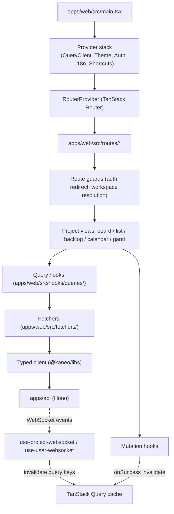

# Kaneo web app

Active contributors: Andrej, Tin, Justin, Erwan, tiran133.

`apps/web` is the React frontend of Kaneo: a Vite single-page application built with TanStack Router (file-based routes under `apps/web/src/routes/`) and TanStack Query for server state. It renders everything a user touches — auth pages, the workspace dashboard, the four project views (board, list, backlog, calendar, gantt), task detail, settings, public project pages, and the MCP authorization page — and it never talks to the API directly: every request goes through the typed client from `@kaneo/libs`, so the API's Zod schemas double as the frontend's types.

## Purpose

- Provide the entire user interface for a Kaneo instance, from sign-in to board editing to billing settings.
- Own client-side concerns only: routing, UI state, server-state caching, realtime cache patching, theming, localization, and keyboard shortcuts. Authorization stays on the API; the web app's permission checks only shape the UI (see [Patterns and conventions](../../how-to-contribute/patterns-and-conventions.md)).
- Stay current with the backend through two channels: TanStack Query invalidation after mutations, and WebSocket events that patch the query cache directly.

## Directory layout

```text
apps/web/
├── index.html
├── vite.config.ts            # Vite + TanStack Router plugin, Tailwind, aliases, Sentry plugin
├── package.json
└── src/
    ├── main.tsx              # bootstrap: provider stack + router creation
    ├── instrument.ts         # Sentry initialization, runs first
    ├── routeTree.gen.ts      # generated route tree (TanStack Router plugin)
    ├── index.css             # global styles, Tailwind v4
    ├── routes/               # file-based route definitions and guards
    ├── components/           # all UI: kanban, calendar, gantt, task, auth, ui primitives
    ├── fetchers/             # one function per API call, typed client only
    ├── hooks/                # queries/, mutations/, websockets, shortcuts, filters
    ├── lib/                  # i18n, auth-client, http-error, toasts, small helpers
    ├── store/                # Zustand client-side stores
    ├── types/                # client-side type definitions
    ├── query-client/         # TanStack QueryClient configuration
    ├── constants/            # column/priority/label colors, project icons, shortcuts
    ├── tanstack/             # devtools wrappers
    └── test/                 # test setup
```

## Key abstractions

| Abstraction | Where | What it does |
| --- | --- | --- |
| Router | `apps/web/src/routes/` + `apps/web/src/routeTree.gen.ts` | File-based TanStack Router; route guards run `beforeLoad`, search params are validated per route. |
| QueryClient | `apps/web/src/query-client/index.ts` | Central retry policy, error classification, Sentry capture, unauthorized redirect. |
| Provider stack | `apps/web/src/main.tsx` | QueryClientProvider, ThemeProvider, AuthProvider, AppI18nProvider, KeyboardShortcutsProvider, ErrorBoundary. |
| Typed client | `@kaneo/libs` (via `apps/web/src/fetchers/`) | The only HTTP layer; route Zod schemas are the frontend types. |
| Auth client | `apps/web/src/lib/auth-client.ts` | Better Auth client with org, device-flow, API-key, OTP, magic-link, and OAuth plugins. |
| Query hooks | `apps/web/src/hooks/queries/` | `useQuery` wrappers with stable query keys. |
| Mutation hooks | `apps/web/src/hooks/mutations/` | `useMutation` wrappers that invalidate query keys and toast on success/error. |
| WebSocket hooks | `apps/web/src/hooks/use-project-websocket.ts`, `apps/web/src/hooks/use-user-websocket.ts` | Realtime cache patching per project and per user. |
| Client stores | `apps/web/src/store/` | Zustand stores for project data, bulk selection, user preferences. |
| i18n | `apps/web/src/lib/i18n/` + `i18n/` | i18next with lazy-loaded locale JSON; `i18n/en-US.json` is the key source of truth. |

## How it works



The router is created once in `apps/web/src/main.tsx` with a context carrying `queryClient` and `user`; the `App` component re-renders the `RouterProvider` with the current user whenever the auth session changes. The TanStack Router Vite plugin (`tanstackRouter` in `apps/web/vite.config.ts`) generates `apps/web/src/routeTree.gen.ts` during dev and build, with auto code splitting; co-located route tests are excluded via `routeFileIgnorePattern`.

Route guards are where navigation decisions happen: `apps/web/src/routes/_layout/_authenticated.tsx` redirects unauthenticated users to sign-in, `apps/web/src/routes/auth.tsx` redirects signed-in users away from auth pages, and `apps/web/src/routes/_layout/_authenticated/dashboard/index.tsx` resolves the active workspace in `beforeLoad` before rendering anything.

## Integration points

- **API**: all data flows through `@kaneo/libs`; base URL comes from `VITE_API_URL` (see `apps/web/src/fetchers/get-api-url.ts`). Changing a request or response schema in `apps/api` is a breaking change here — see [Patterns and conventions](../../how-to-contribute/patterns-and-conventions.md).
- **Auth**: Better Auth client in `apps/web/src/lib/auth-client.ts` shares the server's session, organization, device-flow, and API-key setup (see [apps/api/auth](../api/auth.md)).
- **Realtime**: project- and user-scoped WebSockets patch the TanStack Query cache (see [Realtime](../../features/realtime.md) and [routing-and-state](routing-and-state.md)).
- **Permissions**: `apps/web/src/lib/permissions.ts` re-exports `@kaneo/permissions` for UI capability checks only.
- **i18n**: locale JSON lives at the repo root in `i18n/` (`i18n/en-US.json` is the source of truth); the web app resolves them through the `@i18n/*` alias mapped in `apps/web/tsconfig.app.json` and `apps/web/vite.config.ts`.
- **Observability**: Sentry is initialized in `apps/web/src/instrument.ts`; the QueryClient reports query/mutation failures with deduplication.

## Entry points for modification

- **New page**: add a route file under `apps/web/src/routes/`; the plugin regenerates the route tree automatically.
- **New API call**: add a fetcher in `apps/web/src/fetchers/<feature>/`, wrap it in a query or mutation hook, and keep query keys consistent so invalidation and WebSocket patching line up.
- **New UI surface**: build it from the primitives in `apps/web/src/components/ui/`, mount it in a route, and add any user-facing copy as i18n keys in `i18n/en-US.json` (then run `pnpm i18n:check:fix`).
- **Verify**: `pnpm --filter @kaneo/web typecheck` and `pnpm --filter @kaneo/web test` cover the app; Biome formatting is enforced by the repo's `pnpm lint`.

## Key source files

| File | What it defines |
| --- | --- |
| `apps/web/src/main.tsx` | Bootstrap, provider stack, router creation, crash fallback. |
| `apps/web/src/routes/__root.tsx` | Root route: ToastProvider and the full-height app shell. |
| `apps/web/src/routeTree.gen.ts` | Generated route tree (do not edit by hand). |
| `apps/web/vite.config.ts` | Vite config: TanStack Router plugin, Tailwind, aliases, Sentry sourcemap upload. |
| `apps/web/src/query-client/index.ts` | QueryClient with error classification, retries, Sentry reporting. |
| `apps/web/src/lib/auth-client.ts` | Better Auth client configuration. |
| `apps/web/src/instrument.ts` | Sentry initialization. |

## Related pages

- [overview/architecture](../../overview/architecture.md) — system architecture and the request lifecycle
- [apps/api](../../api/index.md) and [apps/api/auth](../api/auth.md) — the backend this app talks to
- [apps/web/routing-and-state](routing-and-state.md) — data flow, auth state, realtime patching, i18n
- [apps/web/ui-components](ui-components.md) — the major UI surfaces
- [packages/libs](../../packages/libs.md) — the typed client package
- [features/realtime](../../features/realtime.md) — the WebSocket/Redis path in depth
- [how-to-contribute/patterns-and-conventions](../../how-to-contribute/patterns-and-conventions.md) — fetcher and hook conventions
