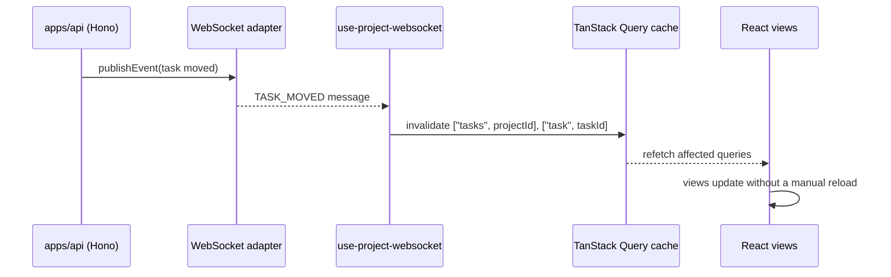

# Routing and state

Active contributors: Andrej, Tin, Justin, Erwan, tiran133.

Everything in `apps/web` is either routing (TanStack Router) or state (TanStack Query server state, Zustand client state, Better Auth session state). This page walks the full path a piece of data takes: route → query hook → fetcher → typed client → API → cache, plus the WebSocket side channel that keeps the cache current without polling.

## Provider stack and bootstrap

`apps/web/src/main.tsx` mounts, in order:

1. `ErrorBoundary` with a generic crash fallback (the raw error is still sent to Sentry; it is not rendered).
2. `QueryClientProvider` with the shared `QueryClient` from `apps/web/src/query-client/index.ts`.
3. `ThemeProvider` (`apps/web/src/components/providers/theme-provider/index.tsx`) — applies `light`/`dark` classes to `document.documentElement` from the user-preferences store, following the system scheme when set to `system`.
4. `AuthProvider` (`apps/web/src/components/providers/auth-provider/index.tsx`) — exposes `user`, `isLoading`, and `refetchUser` through `AuthContext`.
5. `AppI18nProvider` (`apps/web/src/lib/i18n/provider.tsx`) — resolves the locale and preloads namespaces.
6. `KeyboardShortcutsProvider` (`apps/web/src/hooks/use-keyboard-shortcuts.ts`) — a registry for single, sequential (prefix + key), and modifier shortcuts, with `useRegisterShortcuts` used by views to declare their own.

The router context carries `queryClient` and the current `user`; `App` re-renders the `RouterProvider` with the latest user from `useAuth()` so the session change flows into route context.

## File-based routing

Routes live in `apps/web/src/routes/` and are compiled into `apps/web/src/routeTree.gen.ts` by the TanStack Router plugin in `apps/web/vite.config.ts`. The route groups:

| Route group | Files | Behavior |
| --- | --- | --- |
| `__root.tsx` | `apps/web/src/routes/__root.tsx` | ToastProvider and the full-height app shell. |
| `/_layout` | `apps/web/src/routes/_layout.tsx` | Pathless layout that mounts `CommandPalette` and `SearchCommandMenu` around every child. |
| `/_layout/_authenticated` | `apps/web/src/routes/_layout/_authenticated.tsx` | Session guard: `beforeLoad` fetches the session and redirects to `/auth/sign-in?redirect=...` when unauthenticated. |
| `/auth` | `apps/web/src/routes/auth.tsx`, `apps/web/src/routes/auth/` | Sign-in, sign-up, verify-otp, check-email; redirects signed-in users to `/dashboard`. |
| `/device` | `apps/web/src/routes/device.tsx`, `apps/web/src/routes/device/` | Device-flow authorization pages (CLI/MCP clients). |
| `/invitation` | `apps/web/src/routes/invitation/accept.$inviteId.tsx` | Accepting a workspace invitation by link. |
| `/public-project/$projectId` | `apps/web/src/routes/public-project.$projectId.tsx` | Read-only public project view (kanban or list) for shared links. |
| `/mcp/authorize` | `apps/web/src/routes/mcp.authorize.tsx` | OAuth-style consent page for MCP client connections; validates a `request_id` search param. |
| `/test-error` | `apps/web/src/routes/test-error.tsx` | Manual error-boundary test page. |

Route params (`$workspaceId`, `$projectId`, `$taskId`) and search params are typed per route. The board route (`apps/web/src/routes/_layout/_authenticated/dashboard/workspace/$workspaceId/project/$projectId/board.tsx`) validates a `taskId` search param that opens the task details sheet; the gantt and calendar routes do the same. Navigation is always typed through `useNavigate()` and `navigate({ to: "/dashboard/workspace/$workspaceId/project/$projectId/task/$taskId", params: ... })`, so a wrong param name is a type error.

The full task page route file is `$taskId_.tsx` (`apps/web/src/routes/_layout/_authenticated/dashboard/workspace/$workspaceId/project/$projectId/task/$taskId_.tsx`), which matches the URL `/task/$taskId`; the board and other views open the lighter `TaskDetailsSheet` instead of navigating. Settings pages are split into `settings/workspace/*`, `settings/projects/$projectId/*`, and `settings/account/*` layouts with `apps/web/src/components/settings-layout.tsx` providing the sidebar shell.

## Auth state

Better Auth's React client (`apps/web/src/lib/auth-client.ts`) owns the session. `AuthProvider` wraps `authClient.useSession()` and publishes `user`, `isLoading`, and `refetchUser` through context. Two details matter when touching this path:

- The session fetch uses Better Auth's nanostores, not TanStack Query, so the QueryClient's error handling does not apply to it; `AuthProvider` tags transient Safari "Load failed" errors for Sentry separately.
- The loading skeleton renders only during the *first* session fetch. Better Auth refetches the session on window focus; keeping the skeleton for every background refetch would unmount the route tree on alt-tab and tear down the Turnstile iframe.

Unauthorized responses anywhere (query cache, mutation cache, or direct fetcher calls in route loaders) funnel through `handleUnauthorized()` in `apps/web/src/lib/http-error.ts`, which stashes the current path and replaces the location with `/auth/sign-in?redirect=<path>` so the user returns where they left off.

## Fetchers → query hooks → cache invalidation

Each API operation is one fetcher function in `apps/web/src/fetchers/<feature>/`, e.g. `apps/web/src/fetchers/task/get-tasks.ts`:

```ts
const response = await client.task.tasks[":projectId"].$get({
  param: { projectId },
  query: {},
});
if (!response.ok) throw new HttpError(response.status, "Failed to fetch tasks");
return (await response.json()).data;
```

Fetchers never hand-roll `fetch`; they call the typed client and throw `HttpError` (from `apps/web/src/lib/http-error.ts`) on non-OK responses. Query hooks wrap them with stable query keys: `apps/web/src/hooks/queries/task/use-get-tasks.ts` uses `["tasks", projectId]` and keeps a 30-second `refetchInterval` as a safety net, while `apps/web/src/hooks/queries/task/use-get-task.ts` uses `["task", taskId]` with `refetchOnMount: "always"` because single-task data is volatile.

Mutation hooks wrap fetchers and do the real invalidation work. `apps/web/src/hooks/mutations/task/use-move-task.ts` is representative: on success it invalidates `["task", taskId]`, `["tasks", sourceProjectId]`, `["tasks", destinationProjectId]`, `["projects"]`, `["activities", taskId]`, and `["notifications"]`, then toasts the success message; on error it toasts the `HttpError` message or a translated fallback. The recurring convention: one mutation may touch several query keys, and every key it invalidates is a key some query hook reads.

The QueryClient (`apps/web/src/query-client/index.ts`) sets the global defaults: no refetch on window focus or mount, no retry for network or unauthorized errors and at most two retries otherwise, no mutation retries. Its `QueryCache`/`MutationCache` error handlers classify errors — cancellations are ignored, network-class errors are deduplicated before Sentry capture, and any 401 triggers `handleUnauthorized()`.

## Realtime cache patching

The WebSocket hooks are the second writer to the query cache:

- `apps/web/src/hooks/use-project-websocket.ts` — connects to `{wsBase}/{projectId}?windowId=...` (URL from `getApiUrl("ws")` plus a `windowId` from `@kaneo/libs`), sends a `ping` every 30 seconds to stay under Cloudflare's 100-second idle timeout, and reconnects with exponential backoff (1s, 2s, 4s, 8s, 16s; max 5 attempts). On `TASK_UPDATED`, `TASK_CREATED`, `TASK_DELETED`, `TASK_LABEL_UPDATED`, `TASK_MOVED`, `TASK_RELATION_UPDATED`, or `COMMENT_UPDATED` it invalidates the matching keys (`["tasks", projectId]`, `["task", taskId]`, `["labels", taskId]`, `["activities", taskId]`, `["comments", taskId]`, `["task-relations", ...]`). It is mounted by `apps/web/src/components/common/project-layout.tsx` and `apps/web/src/components/common/task-layout.tsx`.
- `apps/web/src/hooks/use-user-websocket.ts` — same connection logic against `/user`, invalidating `["notifications"]` on `NOTIFICATION_CREATED`. It is mounted once by `apps/web/src/components/workspace-switcher.tsx`.

Both hooks derive the URL from the session and skip connecting while signed out. Malformed messages are ignored, and cleanup marks retries exhausted so an unmounted hook never reconnects.



## i18n

`apps/web/src/lib/i18n/index.ts` initializes i18next with a `resourcesToBackend` backend that lazy-imports locale JSON through the `@i18n/resources` alias (mapped to the repo-root `i18n/` directory in `apps/web/tsconfig.app.json` and `apps/web/vite.config.ts`). Locale resolution in `resolveLocale()` prefers the user's saved locale, falls back to the browser locale (with language-code matching, so `en-GB` matches `en-US`), and finally to `defaultLocale`. Components subscribe only to the default namespace and reference others with `t("namespace:key")`, so `preloadNamespaces()` registers every namespace present in the loaded locale JSON after init and on each locale change. `AppI18nProvider` (`apps/web/src/lib/i18n/provider.tsx`) calls `changeLanguage()` when the user's locale changes and sets `document.documentElement.lang`.

`i18n/en-US.json` is the source of truth for keys (roughly 20+ locale files mirror it). Three root scripts keep translations honest: `pnpm i18n:check` / `pnpm i18n:check:fix` (`scripts/i18n/check.mjs`) verifies every locale matches the key schema, `pnpm i18n:report` / `pnpm i18n:report:fix` measures translation coverage, and `pnpm i18n:schema` regenerates `i18n/schema.json`. New user-facing copy goes in `i18n/en-US.json` first, then `pnpm i18n:check:fix` propagates the key to the other locales.

## Client-side stores

`apps/web/src/store/` holds the small Zustand stores that are genuinely client state rather than server state:

| Store | Purpose |
| --- | --- |
| `apps/web/src/store/project.ts` | The current project object with tasks, kept in sync with the `["tasks", projectId]` query result. |
| `apps/web/src/store/bulk-selection.ts` | Board bulk selection and j/k keyboard focus tracking. |
| `apps/web/src/store/backlog-bulk-selection.ts` | Backlog bulk selection. |
| `apps/web/src/store/user-preferences.ts` | Theme, locale, and per-view mode (board vs list) preferences, persisted locally. |

User preferences drive the `ThemeProvider` and the board/list view toggle on the project board route; the project store feeds the kanban and list views without re-reading the query result on every render.

## Key source files

| File | What it defines |
| --- | --- |
| `apps/web/src/main.tsx` | Provider stack and router creation. |
| `apps/web/src/routes/_layout/_authenticated.tsx` | Authentication guard with redirect. |
| `apps/web/src/components/providers/auth-provider/index.tsx` | AuthContext: `user`, `isLoading`, `refetchUser`. |
| `apps/web/src/query-client/index.ts` | QueryClient error classification, retries, Sentry reporting, unauthorized redirect. |
| `apps/web/src/fetchers/task/get-tasks.ts` | Representative fetcher: typed client call + `HttpError`. |
| `apps/web/src/hooks/queries/task/use-get-tasks.ts` | Query hook with stable keys and fallback polling. |
| `apps/web/src/hooks/mutations/task/use-move-task.ts` | Mutation hook with multi-key invalidation and toasts. |
| `apps/web/src/hooks/use-project-websocket.ts` | Project-scoped realtime cache patching. |
| `apps/web/src/hooks/use-user-websocket.ts` | User-scoped notification cache patching. |
| `apps/web/src/lib/i18n/index.ts` | i18next init, locale resolution, namespace preloading. |
| `apps/web/src/lib/http-error.ts` | `HttpError`, `isUnauthorizedError`, `handleUnauthorized`. |

## Related pages

- [apps/web](index.md) — bootstrap, routing layout, and the rest of the app structure
- [overview/architecture](../../overview/architecture.md) — the API request lifecycle this client rides
- [packages/libs](../../packages/libs.md) — the typed client package
- [features/realtime](../../features/realtime.md) — the WebSocket/Redis path in depth
- [how-to-contribute/patterns-and-conventions](../../how-to-contribute/patterns-and-conventions.md) — the fetcher/hook conventions this page applies
