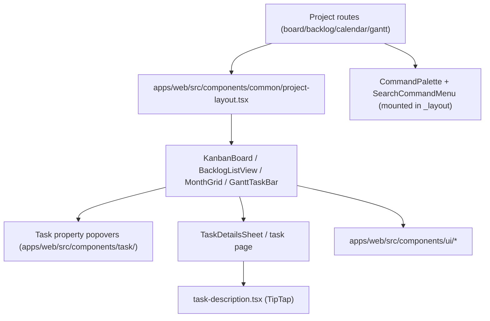

# UI components

Active contributors: Andrej, Tin, Justin, Erwan, tiran133.

`apps/web/src/components/` holds every UI surface in the app, from the layout shell down to the design-system primitives. The feature-level components are deliberately thin wrappers over data: they read query hooks, render primitives, and call mutation hooks. This page describes the major surfaces — the four project views, task detail, command palette, and the primitive library — and where each one lives.

## Layout shell

The authenticated app is assembled from layout components in `apps/web/src/components/common/`:

- `apps/web/src/components/common/layout.tsx` — the main app frame with the sidebar.
- `apps/web/src/components/workspace-switcher.tsx` — workspace dropdown, mounts `useUserWebSocket()`.
- `apps/web/src/components/app-sidebar.tsx`, `nav-main.tsx`, `nav-projects.tsx` — sidebar navigation and the project list.
- `apps/web/src/components/common/workspace-layout.tsx`, `project-layout.tsx`, `task-layout.tsx` — per-level chrome (breadcrumbs, view switcher, create buttons). `project-layout.tsx` mounts `useProjectWebSocket(projectId)` and renders the board/list/backlog/calendar/gantt view switcher.
- `apps/web/src/components/settings-layout.tsx` — the settings sidebar with account, workspace, and project sections.

## Kanban board

`apps/web/src/components/kanban-board/` is the core view, driven by `dnd-kit`:

- `apps/web/src/components/kanban-board/index.tsx` — `DndContext` with mouse, touch, and keyboard sensors, a `DragOverlay`, and a 300ms drop animation. Drag-and-drop is disabled (via huge activation constraints) when the board is sorted by anything other than position, since reordering a sorted view would fight the sort. It also registers `j`/`k`/`Enter` shortcuts through the bulk-selection store to move focus between cards.
- `apps/web/src/components/kanban-board/column/` — column wrapper, header, and dropzone.
- `apps/web/src/components/kanban-board/task-card.tsx` — the card itself: title, labels, assignee, due-date status, priority; context menu in `apps/web/src/components/kanban-board/task-card-context-menu/`.
- `apps/web/src/components/kanban-board/task-labels.tsx` — label chips on cards.

Board interactions call mutation hooks such as `useUpdateTask` (`apps/web/src/hooks/mutations/task/use-update-task.ts`) for drag-moves; the board route (`apps/web/src/routes/_layout/_authenticated/dashboard/workspace/$workspaceId/project/$projectId/board.tsx`) holds the toolbar and filter state (`apps/web/src/components/board/board-toolbar.tsx` + `apps/web/src/hooks/use-task-filters-with-labels-support.ts`), a 30-second-polled `useGetTasks` query, and the `taskId` search param that opens `TaskDetailsSheet`.

## List and backlog views

- `apps/web/src/components/list-view/` — a sortable single-column list of tasks (`index.tsx`, `task-row.tsx`) using the same dnd-kit setup as the board; it is the "list" mode of the board route's view toggle.
- `apps/web/src/components/backlog-list-view/` — the backlog view (`index.tsx`, `backlog-task-row.tsx`): tasks grouped under columns with drag support, framer-motion transitions, and the bulk-selection toolbar (`apps/web/src/components/bulk-selection/backlog-bulk-toolbar.tsx`).

## Calendar

`apps/web/src/components/calendar/` renders the month calendar route (`.../project/$projectId/calendar.tsx`):

- `apps/web/src/components/calendar/month-grid.tsx` — the 7-column month grid.
- `apps/web/src/components/calendar/month-grid-model.ts` — pure lane-packing logic (how task bars share a day without overlapping) with its own unit tests; the only way to change layout behavior safely.
- `apps/web/src/components/calendar/calendar-task-bar.tsx`, `day-overflow-popover.tsx`, `calendar-toolbar.tsx` — task bars, the "+N more" popover, and month navigation.

Dates are handled with `date-fns`; the `react-day-picker` wrapper in `apps/web/src/components/ui/calendar.tsx` is the reusable date-picker primitive.

## Gantt

The gantt view is mostly route logic in `apps/web/src/routes/_layout/_authenticated/dashboard/workspace/$workspaceId/project/$projectId/gantt.tsx` (timeline computation, zoom, today marker); the rendering primitive is `apps/web/src/components/gantt/gantt-task-bar.tsx`, a draggable bar whose edges update the task's start and due dates through mutation hooks. There is a component test alongside the route (`gantt.test.tsx`).

## Task detail surfaces

Task detail is opened two ways: as a full page (`apps/web/src/routes/_layout/_authenticated/dashboard/workspace/$workspaceId/project/$projectId/task/$taskId_.tsx`) and as a sheet over the board (`apps/web/src/components/task/task-details-sheet.tsx`). Both render `apps/web/src/components/task/task-details-content.tsx`, which composes:

- `apps/web/src/components/task/task-title.tsx` — inline title editing.
- `apps/web/src/components/task/task-properties-sidebar.tsx` — status, priority, assignee, dates, labels, custom fields.
- `apps/web/src/components/task/task-subtasks.tsx` — subtask list and add flow.
- `apps/web/src/components/task/task-relations.tsx` — typed links (blocks, blocked by, relates to, duplicates).
- `apps/web/src/components/task/task-delete-button.tsx` — delete with confirmation.
- `apps/web/src/components/task/task-page-skeleton.tsx` — loading state.

The property popovers (assignee, priority, status, due date, start date, labels, move project) are their own components in `apps/web/src/components/task/` (e.g. `task-assignee-popover.tsx`, `task-status-popover.tsx`, `task-move-popover.tsx`), each with tests where behavior is non-trivial.

### Rich-text description editor

`apps/web/src/components/task/task-description.tsx` (about 2,000 lines) is the biggest single component in the app: a TipTap editor with `StarterKit`, Markdown serialization, tables, task lists, images (uploaded via `apps/web/src/lib/upload-task-image.ts`), slash commands, a bubble menu, and custom extensions in `apps/web/src/components/task/extensions/` — `kaneo-issue-link.tsx` (links to other Kaneo tasks), `embed-block.ts` (YouTube/URL embeds), `mermaid-block.ts` (renders Mermaid diagrams), `shiki-code-block.ts` (Shiki syntax highlighting with a language picker), `attachment-card.tsx`, `task-item-with-checkbox.tsx`, and the `@`-mention extensions (`kaneo-mention.tsx`, `mention-suggestion.tsx`, `mention-list.tsx`). Saving is debounced (700ms) through `useUpdateTaskDescription` (`apps/web/src/hooks/mutations/task/use-update-task-description.ts`), and permission checks come from `useWorkspacePermission` (`apps/web/src/hooks/use-workspace-permission.ts`). The activity/comment editor reuses the same TipTap machinery in `apps/web/src/components/activity/comment-editor.tsx`, with the feed in `apps/web/src/components/activity/index.tsx` and `comment-card.tsx`.

## Command palette and search

- `apps/web/src/components/command-palette/index.tsx` — the ⌘K palette: navigation actions, create workspace/project/task dialogs, theme switching, and a hand-off to the search menu. Mounted once from `apps/web/src/routes/_layout.tsx`.
- `apps/web/src/components/search-command-menu/index.tsx` — full-text task search backed by the search query hooks; also mounted from `apps/web/src/routes/_layout.tsx` and opened via the palette or the search page (`apps/web/src/routes/_layout/_authenticated/dashboard/workspace/$workspaceId/search.tsx`).
- `apps/web/src/components/keyboard-shortcuts-help.tsx` — the shortcut reference dialog, rendered alongside the app from `apps/web/src/main.tsx`; shortcuts themselves are declared through `apps/web/src/hooks/use-keyboard-shortcuts.ts` and enumerated in `apps/web/src/constants/shortcuts.ts`.

## Public project views

`apps/web/src/components/public-project/` renders the read-only page for shared project links (`apps/web/src/routes/public-project.$projectId.tsx`): `kanban-view.tsx` and `list-view.tsx` (simplified versions of the authenticated views), `task-detail-modal.tsx`, plus branding, theme toggle, copy-url, and error/loading states. No mutation hooks are used on this surface.

## Design-system primitives

`apps/web/src/components/ui/` is the design-system layer: roughly 65 components (button, dialog, sheet, popover, menu, select, combobox, sidebar, toast, form, tabs, tooltip, kbd, and more) built on Radix/Base UI with Tailwind styling via `apps/web/src/lib/cn.ts`. Feature components compose these primitives; they are the place to change a shared look or behavior, and the `ui/` folder is where new primitives belong rather than bespoke markup inside a feature component. Shared cross-feature dialogs (create task, create project, create workspace, archive tasks) live in `apps/web/src/components/shared/modals/`.

## Key source files

| File | What it defines |
| --- | --- |
| `apps/web/src/components/kanban-board/index.tsx` | dnd-kit board: sensors, drag overlay, drop animation, j/k focus. |
| `apps/web/src/components/kanban-board/task-card.tsx` | The board card and its actions. |
| `apps/web/src/components/backlog-list-view/index.tsx` | Backlog view with grouped columns and bulk actions. |
| `apps/web/src/components/list-view/index.tsx` | Sortable list mode of the board route. |
| `apps/web/src/components/calendar/month-grid.tsx` | Calendar month grid. |
| `apps/web/src/components/calendar/month-grid-model.ts` | Pure lane-packing logic (unit-tested). |
| `apps/web/src/components/gantt/gantt-task-bar.tsx` | Draggable gantt bar primitive. |
| `apps/web/src/components/task/task-details-content.tsx` | The task detail surface composed from popovers, subtasks, relations. |
| `apps/web/src/components/task/task-description.tsx` | TipTap rich-text editor with custom extensions. |
| `apps/web/src/components/task/extensions/` | Editor extensions: issue links, embeds, mermaid, Shiki code blocks. |
| `apps/web/src/components/command-palette/index.tsx` | ⌘K command palette. |
| `apps/web/src/components/search-command-menu/index.tsx` | Full-text task search menu. |
| `apps/web/src/components/ui/` | The design-system primitive library. |
| `apps/web/src/components/public-project/` | Read-only public project views. |

## Related pages

- [apps/web](index.md) — bootstrap, routing layout, and app structure
- [apps/web/routing-and-state](routing-and-state.md) — the query/mutation hooks these components consume
- [how-to-contribute/patterns-and-conventions](../../how-to-contribute/patterns-and-conventions.md) — fetcher and hook conventions
- [features/realtime](../../features/realtime.md) — how project/task changes reach these views
