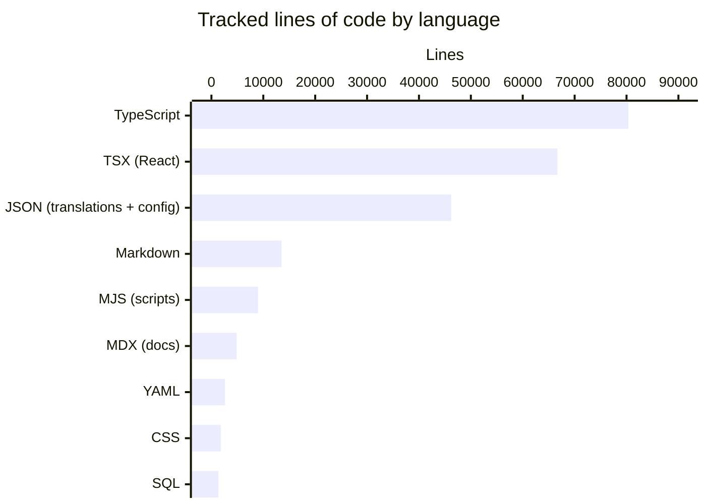

# Kaneo by the numbers

Data collected on September 24, 2026. All figures come from `git` history on `origin/main` (3,014 commits as of that date) and from the tracked files in the working tree.

## Size

The repository tracks roughly 147,000 lines of TypeScript and TSX across 1,304 `.ts`/`.tsx` files, of which 167 are test files. That's a 1:8 test-file-to-source-file ratio. The monorepo holds 4 apps (`api`, `web`, `docs`, `site`) and 6 packages (`libs`, `email`, `permissions`, `mcp`, `planka-import`, `typescript-config`).

A few caveats on the chart:

- Raw JSON is actually the largest bucket at ~178,000 lines across 98 files, but roughly 131,000 of those are generated and committed: Drizzle migration snapshots, the generated OpenAPI spec in `apps/docs/openapi.json`, and the i18n schema. The bar above shows only translation files (20 locale files, ~45,000 lines) plus small config JSON.
- SQL (1,348 lines across 47 files) is almost entirely Drizzle migrations, not hand-maintained queries.
- TypeScript and TSX are split because `.tsx` files (React components) are a distinct majority of the web app's surface.

Unsurprisingly for a project that started as a kanban board, the web app dominates raw size: the single largest source files (see [Complexity](#complexity)) are almost all `apps/web` components, and `apps/web` and `apps/api` also lead every other size and churn metric.

## Activity

Commit volume tells a clear story: a fast start, a quiet gap, then a 2026 ramp.

| Period | Commits |
|---|---|
| 2024 Q4 (Dec only) | 4 |
| 2025 Q1 | 400 |
| 2025 Q2 | 222 |
| 2025 Q3 | 126 |
| 2025 Q4 | 317 |
| 2026 Q1 | 694 |
| 2026 Q2 | 431 |
| 2026 Q3 (through Sep 24) | 820 |

January 2025 was the hottest month of the first year with 208 commits — most of the core product (auth, workspaces, projects, the kanban board) landed within its first six weeks. Volume then cooled steadily through mid-2025, bottoming out in September 2025 with 2 commits and October 2025 with 9: the run-up to Version 2 happened on branches. After v2.0.0 shipped (October 23, 2025) the cadence changed: December 2025 jumped to 271 commits, and 2026 became consistently busier, with March 2026 at 364 and August 2026 at 554 — the all-time peak, which also produced 24 releases.

One distortion worth knowing: automated dependency churn inflates the peak months. December 2025's 271 commits included more than 120 from `dependabot[bot]` alone (a single month with over a hundred `chore(deps)` commits), and March 2026's 364 included 82 bot commits. August 2026 is the genuine human peak — roughly 500 human-authored commits, driven by custom fields, the Planka importer, MCP registry publishing, the Zod OpenAPI refactor, and the Peekareq review bots.

Churn over the 90 days before this snapshot, by directory, matches where the team is spending time:

| Directory | Touched files |
|---|---|
| `apps/web` | 797 |
| `apps/api` | 645 |
| `apps/site` | 174 |
| `scripts/ui-review-bot` | 152 |
| `.github/workflows` | 76 |
| `apps/docs` | 75 |
| `tests/api` | 72 |
| `charts/kaneo` | 68 |
| `tests/api-integration` | 65 |
| `packages/planka-import` | 52 |
| `packages/email` | 37 |
| `packages/mcp` | 36 |

`apps/web` and `apps/api` are the sustained hotspots; everything else rotates.

## Bot-attributed commits

Of the 3,014 commits on `origin/main`, 860 (28.5%) are authored by automation:

- `dependabot[bot]`: 616 commits
- `github-actions[bot]`: 244 commits
- `factory-droid[bot]` and `copilot[bot]`: 0

That leaves 2,154 human-authored commits (71.5%). Two caveats. First, the share is heavily front-loaded: dependency bumps cluster in Dec 2025 and early 2026, so "28.5% bot" overstates the bot share of recent feature work (August 2026 was 91% human). Second, this is a lower bound for AI assistance, not an upper bound — inline AI tools such as Copilot leave no git authorship trace, so their contribution is invisible in this data.

Per-person contribution detail lives on the [maintainers](maintainers.md) page, not here.

## Complexity

The nine largest tracked source files, with a plain-language refactoring hint for each. All line counts are current as of September 24, 2026.

| File | Lines | What it is | Refactoring hint |
|---|---|---|---|
| `apps/web/src/components/task/task-description.tsx` | 1,988 | Task detail description editor | Editor, toolbar, and formatting options grew in place; candidates for extracted editor sub-components |
| `apps/web/src/components/activity/comment-editor.tsx` | 1,979 | Activity/comment editor | Same shape as above; the two editors are the largest UI files by a wide margin |
| `apps/web/src/components/shared/modals/create-task-modal.tsx` | 1,374 | New-task modal | All task fields and options in one modal; field-group components would shrink it |
| `apps/api/src/database/schema.ts` | 1,241 | Entire Drizzle data model | One file holds the whole schema after 46 migrations; a per-domain split is possible but unconventional for Drizzle |
| `apps/web/src/components/account/notification-preferences-settings.tsx` | 1,224 | Notification preferences screen | Every notification type rendered inline |
| `apps/api/src/auth-openapi.ts` | 1,175 | Better Auth OpenAPI wrapper | Generated-adjacent surface kept in one file |
| `tests/api-integration/workspace-rbac.test.ts` | 1,106 | RBAC integration test | Exhaustive roles-by-permission matrix, naturally large |
| `apps/api/src/mcp/tools.ts` | 957 | MCP tool definitions | All MCP tools registered in one module |
| `apps/api/src/index.ts` | 950 | API entry point and router wiring | Assembly code that grew with every new feature route |

None of these are emergencies — the files are large because they are central, not because they are abandoned. Only two TODO/FIXME comments exist in the whole source tree, which is more notable than the file sizes (see [fun-facts](fun-facts.md)).

For architecture context, see [overview/index](overview/index.md) and [overview/architecture](overview/architecture.md). For how the project grew over time, see [lore](lore.md).
