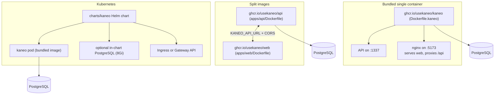

# Deployment

Kaneo runs in three shapes: one bundled container serving both API and web, two separate images that scale independently, and a Helm chart for Kubernetes. All three share a single PostgreSQL database and agree on `KANEO_API_URL` and `KANEO_CLIENT_URL`. A one-click CLI (`drim`) and a Coolify compose file wrap the bundled shape.

## The three deployment shapes



### Bundled single container (default)

`Dockerfile.kaneo` builds the API, the web bundle, and nginx into one image (`ghcr.io/usekaneo/kaneo`) exposing port 5173. `compose.yml` runs that image next to a `postgres:16-alpine` service — the fastest path to a running instance.

The container's startup behavior lives in `deploy/kaneo-entrypoint.sh`:

- Derives `KANEO_API_URL` from `KANEO_CLIENT_URL` (`<client-url>/api`) when not set.
- Derives `DATABASE_URL` from the `POSTGRES_*` variables when not set, and fails fast if neither `DATABASE_URL` nor `POSTGRES_PASSWORD` is present.
- Auto-generates `AUTH_SECRET` when unset — but that secret is random per session, so sessions do not survive a restart; set a real one for anything beyond a throwaway.
- Runs `apps/web/env.sh`, which substitutes the `KANEO_*` placeholders baked into the production bundle at runtime.
- Starts the API on 1337, waits for `GET /api/health`, then starts nginx (`apps/web/nginx.kaneo.conf`), which serves the static web app on 5173, proxies `/api/` to 1337, and serves the MCP OAuth discovery documents under `/.well-known/`.

`compose.local.yml` is the development analogue: it builds `apps/api/Dockerfile` and `apps/web/Dockerfile` as separate services (plus a Mintlify docs container) against a local Postgres.

### Split images

For deployments that want the frontend and backend hosted or scaled independently, the release workflow also publishes `ghcr.io/usekaneo/api` (built by `apps/api/Dockerfile`) and `ghcr.io/usekaneo/web` (built by `apps/web/Dockerfile`). The two services just need to agree on `KANEO_API_URL` and `KANEO_CLIENT_URL`, and the CORS policy must allow the web origin (see [Security](security.md)).

### Helm chart (Kubernetes)

`charts/kaneo` (version `2.25.0` in `charts/kaneo/Chart.yaml`, `kubeVersion >= 1.23`) deploys the bundled image plus an optional in-chart PostgreSQL (`postgresql.enabled`, 8Gi persistence) and supports `postgresql.external` with existing-secret credentials for production clusters. `charts/kaneo/values.yaml` configures:

- `kaneo.env.clientUrl` (with `KANEO_API_URL` derived as `<clientUrl>/api`) and `kaneo.env.corsOrigins` (defaults to `clientUrl`).
- `kaneo.env.authSecret` or an existing Kubernetes secret (`auth-secret` key), with `openssl rand -hex 32` as the documented generator.
- Autoscaling (`autoscaling.enabled`, default off; an HPA up to 10 replicas at 80% CPU), liveness/readiness probes against `/api/health`, ingress (nginx, default off) and Gateway API support, plus `extraEnv`/`extraEnvFrom` for anything the chart does not model (SMTP, SSO, GitHub App, Sentry, Redis).

The chart is validated on pull requests by `.github/workflows/helm-validate.yml` and published to `oci://ghcr.io/usekaneo/charts/kaneo` by `.github/workflows/helm-chart.yml` as part of the release.

## Coolify

`compose.coolify.yml` is a Git-source compose stack for Coolify's "Docker Compose" build pack. It is deliberately minimal: the only required environment variable is `KANEO_CLIENT_URL` (the public URL, without `:5173`); `AUTH_SECRET` and the PostgreSQL password come from Coolify magic variables. Do not set `KANEO_API_URL` — the entrypoint derives it as `<public-url>/api`. `KANEO_IMAGE_TAG` pins the image to a release tag when a redeploy must stay on a known version instead of tracking `latest`.

## drim one-click install

For a path that skips compose entirely, the [drim](https://github.com/usekaneo/drim) CLI handles everything — automatic HTTPS, database setup, and all services configured:

```bash
curl -fsSL https://assets.kaneo.app/install.sh | sh
drim setup
```

## Releasing

Releases are manual and deliberate: a maintainer dispatches the **Release** workflow (`.github/workflows/release.yml`) from `main` with a `release_type` (`auto`/`patch`/`minor`/`major`) and optionally `dry_run`. Nothing releases on a push. The workflow resolves the next version from Conventional Commits, builds and pushes the three images under that version, validates the chart, and only then cuts the release and promotes `:latest`. The full contract lives in `AGENTS.md`'s Releases section.

## Key source files

| File | What it contains |
| --- | --- |
| `Dockerfile.kaneo` | The bundled API + web + nginx image |
| `deploy/kaneo-entrypoint.sh` | Container startup: URL/database/secret derivation, env substitution, API + nginx supervision |
| `apps/web/nginx.kaneo.conf` | nginx config: static web, `/api/` proxy, MCP `/.well-known/` documents |
| `apps/web/env.sh` | Runtime `KANEO_*` placeholder substitution into the built bundle |
| `compose.yml` | Bundled image + Postgres (production default) |
| `compose.local.yml` | Split api/web/docs development build |
| `compose.coolify.yml` | Coolify Git-source stack |
| `charts/kaneo/Chart.yaml` | Chart metadata and version |
| `charts/kaneo/values.yaml` | Chart configuration (database, auth secret, autoscaling, ingress) |
| `.github/workflows/release.yml` | Manual release dispatch orchestration |
| `.github/workflows/build-images.yml` | Matrix build of the kaneo/web/api images |
| `.github/workflows/helm-chart.yml` | Chart validation + publish to GHCR OCI |

## Related pages

- [Architecture](overview/architecture.md) — the two deployable units and the config contract
- [Security](security.md) — CORS, secrets, and the SSRF guard deployments must configure
- [Reference configuration](reference/configuration.md) — the full env-var list
- [Billing](features/billing.md) — why self-hosted installs never see billing routes
