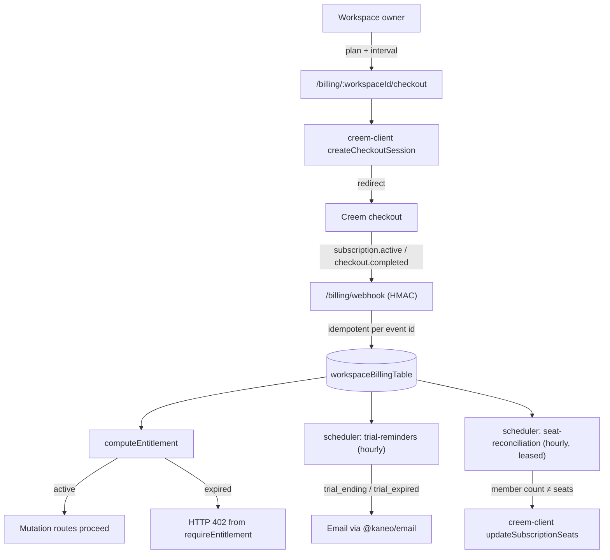

# Billing

> Active contributors: Andrej, justin, Tin

## Purpose

Billing is the paid tier of Kaneo Cloud, powered by [Creem](https://creem.io). It adds a per-workspace subscription state, an entitlement check that gates mutation routes with HTTP 402 once a trial or subscription lapses, and two scheduler jobs that remind owners their trial is ending and reconcile paid seats with workspace membership. The whole feature is compiled in but inert unless the instance opts in: `isBillingEnabled()` requires `KANEO_CLOUD=true` **and** `CREEM_API_KEY` **and** `CREEM_WEBHOOK_SECRET`, and every middleware, route, and scheduler job no-ops or 404s when those are absent — self-hosted installs are unaffected.

## Key abstractions

| Abstraction | Source | What it is |
| --- | --- | --- |
| `isBillingEnabled()` | `apps/api/src/billing/config.ts` | True only when `KANEO_CLOUD=true` plus Creem API key and webhook secret are set. |
| `workspaceBillingTable` | `apps/api/src/database/schema.ts` | One row per workspace: status, plan, interval, seats, trial end, Creem customer/subscription ids, founding flag. |
| `computeEntitlement()` | `apps/api/src/billing/controllers/get-workspace-billing.ts` | Decides active vs. expired from billing state and the clock. |
| `requireEntitlement` | `apps/api/src/billing/require-entitlement-middleware.ts` | Route middleware that 402s expired workspaces; no-ops when billing is disabled. |
| `trialGrantTable` | `apps/api/src/database/schema.ts` | One trial grant per hashed owner email, so trials follow the person, not the workspace. |
| `checkTrialReminders()` | `apps/api/src/scheduler/trial-reminders.ts` | Hourly job that emails owners 3 days before expiry and on the day of expiry. |
| `reconcileWorkspaceSeats()` | `apps/api/src/scheduler/seat-reconciliation.ts` | Hourly job that pushes the current member count to Creem for team plans. |

## Directory layout

| Path | Purpose |
| --- | --- |
| `apps/api/src/billing/index.ts` | Routes: `/billing/webhook` (signature-authenticated), `/billing/{workspaceId}`, `/{workspaceId}/checkout`, `/{workspaceId}/portal`. All are `hide: true` in OpenAPI so the self-hosted API reference does not advertise a paid tier. |
| `apps/api/src/billing/config.ts` | Plan/product env keys, trial days, founding cutoff, billing-enabled check. |
| `apps/api/src/billing/creem-client.ts` | Thin wrapper over the Creem SDK: checkout sessions, subscription seat updates, customer portal links. |
| `apps/api/src/billing/controllers/` | `get-workspace-billing.ts` (state + entitlement), `handle-webhook.ts` (idempotent webhook apply), `create-checkout.ts`, `sync-seats.ts`, `find-billable-workspaces.ts`, `require-entitlement.ts`. |
| `apps/api/src/scheduler/trial-reminders.ts` | Trial reminder emails. |
| `apps/api/src/scheduler/seat-reconciliation.ts` | Seat drift detection and repair. |
| `apps/api/src/scheduler/leader-lock.ts` | PostgreSQL lease so only one API instance runs reconciliation. |

## How it works

### Entitlements and route gating

`requireEntitlement` (`apps/api/src/billing/require-entitlement-middleware.ts`) is meant to run after a workspace-access middleware that sets `c.get("workspaceId")`; it calls `requireWorkspaceEntitlement`, which loads (or lazily creates) the workspace's billing row and throws `HTTPException(402)` when `computeEntitlement` says the workspace has no active entitlement. `computeEntitlement` is the heart of the logic:

- billing disabled → always `active: true` (reason `billing_disabled`)
- `foundingFree` workspaces (created at or before `BILLING_FOUNDING_CUTOFF`) → `founding_free`
- status in `active` / `trialing` / `past_due` / `scheduled_cancel` → `subscription`
- status `canceled` with `currentPeriodEnd` still in the future → `paid_period` (paid through the period)
- `trialEndsAt` in the future → `trial`
- otherwise → `expired`

There is also `requireProjectEntitlement` for project-scoped checks. Which routes carry the middleware is decided per route in the feature routers; the pattern is that mutation-heavy routes (task create/update, project create, invites) are gated.

### Trial lifecycle

Trials are granted per owner, keyed by a hash of the owner's normalized email (`hashTrialEmail` strips `+tags` and lowercases, `apps/api/src/billing/trial-identity.ts`), stored in `trialGrantTable` with `trialEndsAt = now + BILLING_TRIAL_DAYS` (default 14). When a workspace's billing row is first created, `resolveTrialEndsAt` looks for the earliest existing trial of the owner across their workspaces — one trial per person, not per workspace — and claims a new one if none exists. Founding members (workspace created before `BILLING_FOUNDING_CUTOFF`) skip trials entirely with `foundingFree: true`.

`checkTrialReminders()` runs hourly (`23 * * * *`), only when billing and SMTP are both enabled. It finds workspaces whose trial ends in 2–3 days (`trial_ending`) or has already ended (`trial_expired`), dedupes per owner (one email per owner, not per workspace), claims sends in `billingReminderSentTable` to make concurrent runs no-ops, and sends through `sendTrialReminderEmail` from `@kaneo/email` with a deliberate pace (max 25 per run, 600 ms spacing) because the provider rate-limits silently.

### Webhooks

`POST /billing/webhook` is excluded from the app-wide auth middleware — authenticity comes from the Creem signature verified by `constructWebhookEvent` against `CREEM_WEBHOOK_SECRET`. Events are applied idempotently: `billingEventTable` claims each event id inside a transaction, so provider retries are no-ops. `checkout.completed` stores the customer/subscription/product ids and the mapped plan; `subscription.*` events map status (including `subscription.paid` → `active`), current period end, canceled-at, seats, and product-derived plan/interval onto the workspace row via `creemSubscriptionId`.

### Seat reconciliation

`reconcileWorkspaceSeats()` runs hourly (`17 * * * *`) under a PostgreSQL lease (`job_lease` table, `apps/api/src/scheduler/leader-lock.ts`) so only one API instance works at a time. It finds team-plan workspaces with an active/trialing subscription whose member count differs from the stored seat count, then calls `syncWorkspaceSeats`, which pushes the current member count to Creem as subscription item units with `proration-charge` and updates the local row on success. `createCheckout` also pre-sizes the initial team checkout to the current member count.

## Integration points

- `apps/api/src/index.ts` — mounts `/api/billing` and exempts the webhook path from the auth middleware.
- `apps/api/src/scheduler/index.ts` — registers the two hourly jobs with Sentry cron check-ins.
- `apps/api/src/utils/is-cloud.ts` — the `KANEO_CLOUD` gate everything else keys off.
- `@kaneo/email` — `sendTrialReminderEmail` template and SMTP transport (see [packages/email](../packages/email.md)).
- Web app: billing settings live under workspace settings; entitlement failures surface as 402 errors on mutations.

## Entry points for modification

- Add a plan or interval: extend `Plan`/`BillingInterval` and the product env keys in `apps/api/src/billing/config.ts`.
- Change what counts as an active entitlement: `computeEntitlement` in `apps/api/src/billing/controllers/get-workspace-billing.ts`.
- Gate another route: add `requireEntitlement` to the route's middleware chain after a workspace-access middleware.
- Adjust reminder copy or timing: `apps/api/src/scheduler/trial-reminders.ts` and the `TrialReminderEmail` template in `packages/email/src/templates/`.

## Key source files

| File | Purpose |
| --- | --- |
| `apps/api/src/billing/config.ts` | `isBillingEnabled`, plan/product env mapping, trial days, founding cutoff |
| `apps/api/src/billing/creem-client.ts` | Creem SDK calls: checkout, seat update, portal link |
| `apps/api/src/billing/require-entitlement-middleware.ts` | Route gate that 402s expired workspaces |
| `apps/api/src/billing/controllers/get-workspace-billing.ts` | Billing state, lazy row creation, `computeEntitlement`, trial resolution |
| `apps/api/src/billing/controllers/handle-webhook.ts` | Signature-verified, idempotent webhook application |
| `apps/api/src/billing/controllers/sync-seats.ts` | Pushes member count to Creem for team plans |
| `apps/api/src/scheduler/trial-reminders.ts` | Trial ending/expired emails, deduped per owner |
| `apps/api/src/scheduler/seat-reconciliation.ts` | Drift detection + repair with a job lease |
| `apps/api/src/scheduler/leader-lock.ts` | PostgreSQL lease preventing duplicate reconciliation |

## Related pages

- [Notifications](notifications.md) for the email channel trial reminders reuse
- [Packages/email](../packages/email.md) for the SMTP transport and templates
- [Reference configuration](../reference/configuration.md) for `KANEO_CLOUD`, `CREEM_*`, `BILLING_*` env vars
- [Deployment](../deployment.md) for why self-hosted installs never see billing routes
