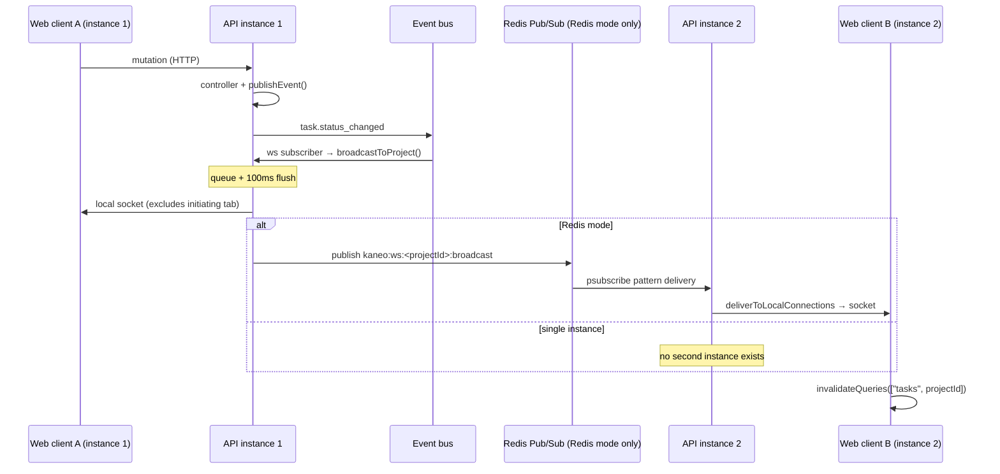

# Realtime

> Active contributors: tiran133, Andrej, shockalotti, Tin

## Purpose

This page goes deeper than the [Architecture overview](../overview/architecture.md) on the WebSocket path: how connections are tracked, how messages are batched and deduplicated, how the `BroadcastAdapter` interface makes Redis optional, and how the web app turns a WebSocket message into a visible UI change. The end-to-end contract is simple — a task mutation publishes an event, the WebSocket layer pushes a small typed message to the clients watching that project (or, for user-scoped events, to one user), and the client invalidates the relevant TanStack Query keys.

## Key abstractions

| Abstraction | Source | What it is |
| --- | --- | --- |
| `projectConnections` | `apps/api/src/ws/index.ts` | `Map<projectId, Set<ProjectConnection>>` — each instance tracks only its own sockets, keyed by project. |
| `userConnections` | `apps/api/src/ws/index.ts` | `Map<userId, Set<UserConnection>>` — user-scoped sockets for events like `NOTIFICATION_CREATED`. |
| `BroadcastAdapter` | `apps/api/src/ws/broadcast-adapter.ts` | Interface with `publish` / `publishToUser` / `subscribe` / `subscribeToUser` / `shutdown`. One of two implementations is chosen at boot. |
| `InMemoryBroadcastAdapter` | `apps/api/src/ws/in-memory-broadcast-adapter.ts` | Single-instance default: `publish` just invokes the local handler directly. |
| `RedisBroadcastAdapter` | `apps/api/src/ws/redis-broadcast-adapter.ts` | Multi-instance fan-out over Redis Pub/Sub with pattern subscriptions. |
| `isRedisConfigured()` | `apps/api/src/redis/index.ts` | True when `REDIS_URL`, `REDIS_SENTINELS`, or `REDIS_CLUSTER_NODES` is set — that alone selects the Redis adapter. |
| `useProjectWebSocket` / `useUserWebSocket` | `apps/web/src/hooks/use-project-websocket.ts` / `apps/web/src/hooks/use-user-websocket.ts` | Client hooks that connect, ping, retry, and invalidate query caches on incoming messages. |

## Directory layout

| Path | Purpose |
| --- | --- |
| `apps/api/src/ws/index.ts` | Connection registries, batching queues, event subscriptions, and the two broadcast endpoints' logic. |
| `apps/api/src/ws/broadcast-adapter.ts` | The `BroadcastAdapter` interface and message types. |
| `apps/api/src/ws/in-memory-broadcast-adapter.ts` | Single-instance adapter. |
| `apps/api/src/ws/redis-broadcast-adapter.ts` | Redis Pub/Sub adapter. |
| `apps/api/src/redis/index.ts` | Redis client creation (standalone / sentinel / cluster) and pub/sub client accessors. |
| `apps/api/src/index.ts` | Mounts `/ws/user` and `/ws/:projectId` upgrade endpoints with authentication. |
| `apps/web/src/hooks/use-project-websocket.ts` | Project-scoped client connection. |
| `apps/web/src/hooks/use-user-websocket.ts` | User-scoped client connection. |

## How it works

### Endpoints and connection tracking

Two WebSocket endpoints are mounted in `apps/api/src/index.ts`. Both authenticate the raw request with `authenticateApiRequest` (they run outside the regular route pipeline), and `/ws/:projectId` additionally validates workspace access on the project. The upgrade handlers compute an `initiatorId` of `${userId}:${windowId}` from the `windowId` query parameter — the same header (`X-Kaneo-Window-Id`) that controllers stamp into event context, so a message the user triggered in one browser tab can be excluded from that same tab's socket while still reaching their other tabs.

`apps/api/src/ws/index.ts` keeps two registries:

- `projectConnections` — `addConnection(projectId, ws, userId, initiatorId)` on open, `removeConnection` on close. Delivery for a project iterates this set.
- `userConnections` — `addUserConnection(userId, ws)` / `removeUserConnection`, used only for user-targeted messages.

The module subscribes to the event bus (`subscribeToEvent`) for `task.moved`, `task-relation.refresh`, `notification.created`, and a fixed list of task update events (`task.created`, `task.updated`, `task.deleted`, status/priority/assignee/due-date/title/description changes, label events, task-relation and comment events). Each subscription calls `broadcastToProject` (or `broadcastToUser` for notifications) with a small message type like `TASK_UPDATED`, `TASK_CREATED`, `TASK_LABEL_UPDATED`, `COMMENT_UPDATED`.

### Batching and deduplication

`broadcastToProject` does not publish immediately. Messages for a project are queued in `projectBroadcastQueues`, keyed by `${type}:${taskId}:${sourceTaskId}:${targetTaskId}` so repeated identical messages collapse, and a per-project 100 ms timer flushes the queue through the adapter once. This turns a burst of related events (say a move that also fires status and assignee changes) into one or a few frames. On shutdown, `shutdownWebSocketAdapter` flushes any pending queue through the adapter before tearing it down.

### Adapter selection and Redis fan-out

`initializeWebSocketAdapter` picks `RedisBroadcastAdapter` when `isRedisConfigured()` is true (any of `REDIS_URL`, `REDIS_SENTINELS`, `REDIS_CLUSTER_NODES` set — `apps/api/src/redis/index.ts` also supports `REDIS_CLUSTER_NODES` and sentinel modes with `REDIS_SENTINEL_MASTER_NAME`), otherwise `InMemoryBroadcastAdapter`. The in-memory adapter delivers in-process; the Redis adapter publishes JSON to a per-project channel (`kaneo:ws:<projectId>:broadcast`) or per-user channel (`kaneo:ws-user:<userId>:broadcast`) using a dedicated pub client, while a separate sub client pattern-subscribes (`psubscribe`) to both channel patterns. Incoming broadcasts are validated with Valibot before delivery, and user broadcasts carry an `origin` (the publishing instance's `INSTANCE_ID`) so the publishing instance skips re-delivering to its own sockets — it already delivered locally in `broadcastToUser`.

With no Redis, the path stops at instance 1: `publish` on the in-memory adapter calls the local subscription handler, which delivers to that instance's sockets. With Redis, every instance subscribed to the pattern receives the message and delivers only to its own connections — so a client connected to instance 2 still gets the update.

### Web app consumption

- `useProjectWebSocket(projectId)` (`apps/web/src/hooks/use-project-websocket.ts`) builds `wss://…/ws/<projectId>?windowId=…`, connects when a project id and session exist, and on `TASK_UPDATED` / `TASK_CREATED` / `TASK_DELETED` / `TASK_LABEL_UPDATED` / `TASK_MOVED` / `TASK_RELATION_UPDATED` / `COMMENT_UPDATED` invalidates the query keys `["tasks", projectId]`, `["task", taskId]`, `["task-relations", …]`, `["labels", taskId]`, and `["comments"|"activities", taskId]` as appropriate. Reconnection uses exponential backoff (`1s, 2s, 4s, …`, max 5 retries).
- `useUserWebSocket()` (`apps/web/src/hooks/use-user-websocket.ts`) connects to `/ws/user?windowId=…` and on `NOTIFICATION_CREATED` invalidates `["notifications"]`.
- Both send a `{"type":"ping"}` every 30 seconds to keep the connection alive past Cloudflare's 100-second idle timeout; the server's `onMessage` treats pings as no-ops.

## Integration points

- `apps/api/src/events/index.ts` — controllers call `publishEvent()`; the ws module subscribes. Nothing else needs to know sockets exist.
- `apps/api/src/index.ts` — the two upgrade endpoints and the `windowId`-based initiator tracking.
- `apps/api/src/redis/index.ts` — shared Redis clients (also used by nothing else at present; the adapter owns pub/sub).
- TanStack Query cache invalidation in the two web hooks — this is how the UI stays fresh without polling.

## Entry points for modification

- Add a new realtime message type: publish an event from the controller, subscribe to it in `apps/api/src/ws/index.ts`, map it to a message type (extend `taskUpdateEvents` or add a dedicated subscription), and handle the type in `use-project-websocket.ts` / `use-user-websocket.ts`.
- Change batching behavior: the queue map and 100 ms flush in `broadcastToProject`.
- Change adapter selection or Redis channel layout: `initializeWebSocketAdapter` in `apps/api/src/ws/index.ts` and the channel constants in `apps/api/src/ws/redis-broadcast-adapter.ts`.

## Key source files

| File | Purpose |
| --- | --- |
| `apps/api/src/ws/index.ts` | Connection tracking, batching queues, event subscriptions, broadcast entry points |
| `apps/api/src/ws/broadcast-adapter.ts` | The `BroadcastAdapter` interface and message types |
| `apps/api/src/ws/in-memory-broadcast-adapter.ts` | Single-instance delivery |
| `apps/api/src/ws/redis-broadcast-adapter.ts` | Redis Pub/Sub fan-out with pattern subscriptions and Valibot validation |
| `apps/api/src/redis/index.ts` | `isRedisConfigured`, `resolveRedisMode`, pub/sub client accessors |
| `apps/api/src/index.ts` | `/ws/user` and `/ws/:projectId` upgrade endpoints |
| `apps/web/src/hooks/use-project-websocket.ts` | Project-scoped client: URL, ping, retry, cache invalidation |
| `apps/web/src/hooks/use-user-websocket.ts` | User-scoped client for `NOTIFICATION_CREATED` |

## Related pages

- [Architecture](../overview/architecture.md) for the high-level realtime path and Redis configuration link
- [Notifications](notifications.md) for what `NOTIFICATION_CREATED` means end to end
- [Patterns and conventions](../how-to-contribute/patterns-and-conventions.md) for the publish/subscribe convention
- [Reference configuration](../reference/configuration.md) for `REDIS_URL` / `REDIS_SENTINELS` / `REDIS_CLUSTER_NODES`
