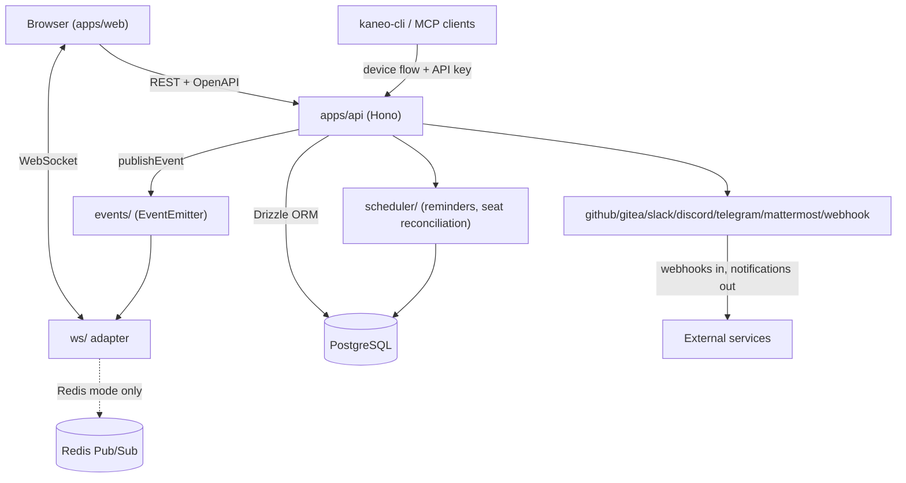
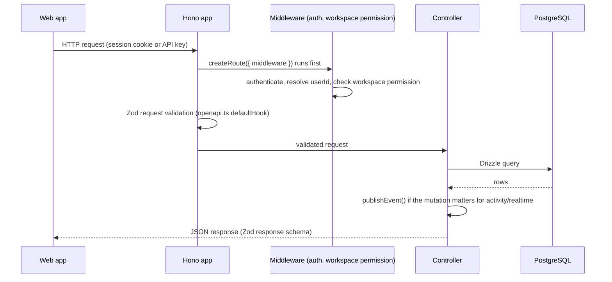
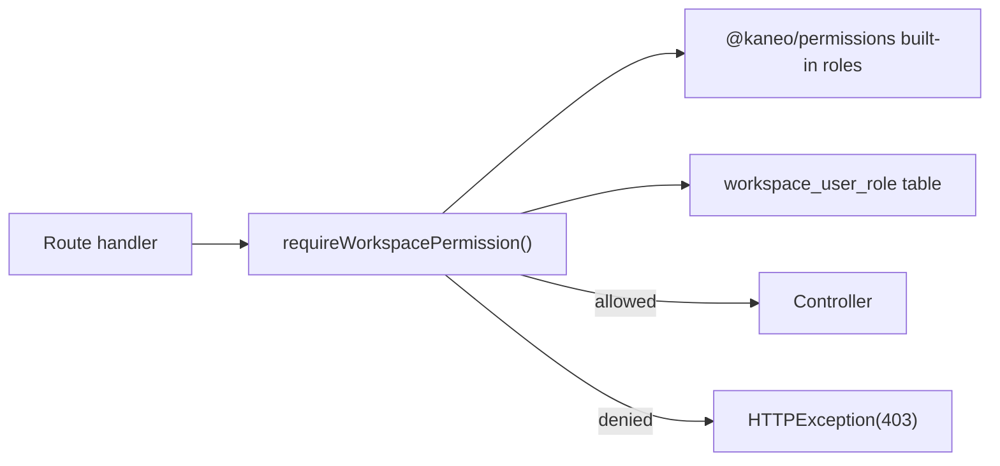

# Architecture

Kaneo runs as two deployable units that share a PostgreSQL database and a typed API contract: the `apps/api` Hono server and the `apps/web` React frontend. In the default Docker image (`Dockerfile.kaneo`) both run inside one container behind a single port; in Kubernetes or a split deployment they can run as separate services that just need to agree on `KANEO_API_URL` and `KANEO_CLIENT_URL`.

## Component overview

`apps/api/src/index.ts` wires all of this together: it builds the Hono app, registers every feature router (`activity`, `task`, `project`, `workspace`, integrations, `billing`, `mcp`, and more), mounts the WebSocket upgrade handler, and runs startup migrations before `serve()` binds a port.

## Request lifecycle

Route middleware declared via `createRoute({ middleware })` runs **before** the request validators, so middleware reads the raw request rather than `c.req.valid()` — that ordering is a recurring source of bugs if a new route assumes otherwise (see `apps/api/src/openapi.ts`).

## Realtime path

A mutation that matters for activity, notifications, or live UI updates calls `publishEvent()` (`apps/api/src/events/index.ts`), which emits on an in-process `EventEmitter`. The WebSocket layer (`apps/api/src/ws/index.ts`) subscribes to the events it cares about and pushes to connected clients scoped by project or user.

For a single API instance, that's the whole path. For multiple instances behind a load balancer, an in-memory `EventEmitter` can't reach clients connected to a different process, so `apps/api/src/ws/broadcast-adapter.ts` defines a `BroadcastAdapter` interface with two implementations: `in-memory-broadcast-adapter.ts` (default, single instance) and `redis-broadcast-adapter.ts` (fans out over Redis Pub/Sub when `REDIS_URL`, `REDIS_SENTINELS`, or `REDIS_CLUSTER_NODES` is set). Redis is deliberately optional — see the [Redis Configuration](https://github.com/usekaneo/kaneo/blob/main/ENVIRONMENT_SETUP.md#redis-configuration) section of `ENVIRONMENT_SETUP.md` — because self-hosting stays single-instance-first by default.

## Data flow: workspace authorization

Every workspace-scoped route is expected to call into the shared permission vocabulary rather than re-implement role checks:

`packages/permissions` is the canonical vocabulary of permission strings and built-in roles (owner, admin, member, guest); the API middleware layer enforces it, and the web app's capability checks mirror it for UI state only. See [Permission model](../primitives/index.md) and [Security](../security.md) for the full boundary discussion.

## The typed client contract

`packages/libs` exports a typed Hono client generated from the API's route types, plus URL helpers. `apps/web` imports this client rather than hand-writing `fetch` calls, so a route's Zod schemas double as the frontend's types. Changing a request or response schema in `apps/api` is a breaking change for `apps/web` and for `apps/docs/openapi.json` (regenerated with `pnpm openapi:check:fix`) at the same time — see [Patterns and conventions](../how-to-contribute/patterns-and-conventions.md).

## Deployment shapes

- **Bundled single container** (`Dockerfile.kaneo`, `compose.yml`): API and web served from one image, one port (5173), Postgres alongside it. This is the default in `README.md` and the fastest path to a running instance.
- **Split images**: `ghcr.io/usekaneo/api` and `ghcr.io/usekaneo/web` for deployments that want the frontend and backend scaled or hosted independently.
- **Helm chart** (`charts/kaneo`): deploys the bundled image plus an optional in-chart PostgreSQL, with autoscaling and existing-secret support for production clusters.

See [Deployment](../deployment.md) for the concrete steps for each shape.

## Related pages

- [Getting started](getting-started.md) for running this locally
- [apps/api](../apps/api/index.md) for the server's internal structure
- [apps/web](../apps/web/index.md) for the frontend's internal structure
- [Realtime](../features/realtime.md) for the WebSocket/Redis path in depth
- [Security](../security.md) for the authorization boundary in depth
