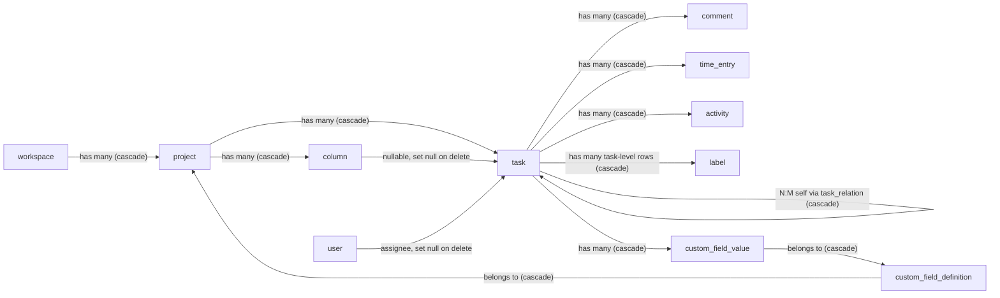

# Task model

> Active contributors: Andrej, Tin, LAZIC, MonsPropre, Ivan, justin, randoneering, shockalotti, Rojenson, Cursor

## Purpose

The task is the unit of work everything else orbits. This page covers the `task` table itself and the supporting tables that hang off it — comments, labels, custom fields, task relations, time entries, and activity — plus what happens to all of them when a task or its owners are deleted. Custom fields and labels are covered as a feature in [Workflow automation](../features/workflow-automation.md); here they are treated as schema concepts.

## Key abstractions

All tables below are defined in `apps/api/src/database/schema.ts`; their relations are in `apps/api/src/database/relations.ts`.

| Table | Purpose | Key foreign keys and delete behavior |
| --- | --- | --- |
| `task` | The unit of work: title, description, status, priority, assignee, dates, and position. `number` is unique per project. | `projectId` cascade; `assignee_id` and `columnId` `set null` |
| `comment` | Discussion on a task. | `taskId` cascade, `userId` cascade |
| `label` | Polymorphic label: a row is either a task label (`taskId` set) or a shared workspace label (`taskId` null). | `taskId` and `workspaceId` cascade |
| `custom_field_definition` | The schema of an extra task attribute, owned by a project. | `projectId` cascade |
| `custom_field_value` | One value per (task, field). | `taskId` and `fieldId` cascade |
| `task_relation` | A typed link between two tasks (blocks, relates to, duplicates). Self-referencing. | `sourceTaskId` and `targetTaskId` cascade |
| `time_entry` | A logged duration against a task. | `taskId` cascade, `userId` `set null` |
| `activity` | Durable, user-visible task history. | `taskId` cascade, `userId` `set null` |
| `asset` | Uploaded files, optionally attached to a task or an activity row. | `workspaceId`, `projectId`, `taskId`, `activityId` cascade; `created_by` `set null` |

## How it works

### Cascade behavior, read from the schema

- **Deleting a task** cascades to everything that references it: comments, time entries, activities, task-level labels, custom field values, external links, assets, task reminders sent, and both sides of every `task_relation` row it participates in (`sourceTaskId` and `targetTaskId` are both `onDelete: "cascade"`).
- **Deleting a project** cascades to its tasks first, which then cascades to all of the above; it also takes columns, workflow rules, custom field definitions, integrations, and notification-project links.
- **Deleting a column** is the one soft spot in the chain: `task.columnId` is `onDelete: "set null"`, so tasks survive and lose their lane.
- **Deleting a user** sets nullable references to `null` — `task.assignee_id`, `time_entry.user_id`, `activity.user_id`, `asset.created_by` — but `comment.userId` and `workspace_member.userId` cascade, so a deleted user's comments and memberships disappear with them.

### Notable constraints

- **Task numbering**: `(projectId, number)` is unique, so task numbers restart or continue per project, fed by `project.lastTaskNumber`.
- **Labels are polymorphic, not a join table**: `label` carries either a `taskId` (task-level label) or a `workspaceId` with `taskId` null (shared workspace label). `(taskId, name)` is unique, and a partial unique index on `(workspaceId, name)` where `taskId is null` enforces unique shared-label names. Assigning a shared label to a task writes a new task-level row — the `taskId` column is the join.
- **Custom fields are two tables**: `custom_field_definition` (per project: name, type, required, options) and `custom_field_value` (per task per field, with `(taskId, fieldId)` unique). Deleting a definition cascades to its values.
- **Activity dedupe**: `(taskId, externalSource, externalUrl)` is unique so the same external event (for example a GitHub PR) can't write duplicate history rows.

## Integration points

- Activity is a consumer of `publishEvent()`: events emitted by mutations in `apps/api/src/events` end up as `activity` rows and realtime WebSocket pushes; the `activity` table keeps `eventData` so the recorded row is the durable trace.
- Realtime and cache invalidation scope by project and user, so a task change reaches the right clients.
- Custom fields and labels as user-facing features: [Workflow automation](../features/workflow-automation.md).
- MCP tools (`packages/mcp`) expose task, project, and label operations backed by these tables.
- See [Data models](../reference/data-models.md) for the full field-by-field reference.
