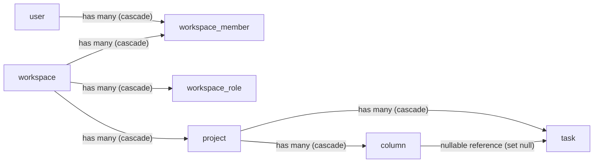

# Workspace and project hierarchy

> Active contributors: Andrej, Tin, LAZIC, MonsPropre, Ivan, justin, randoneering, shockalotti, Rojenson, Cursor

## Purpose

The containment hierarchy — workspace → project → column → task — is the spine of Kaneo's data model. This page covers the tables behind the top three levels and membership: how users attach to a workspace, how roles map onto the role tables, and what happens to child rows when a parent is deleted. Cascade behavior lives here because it is decided in the foreign key declarations, not in application code.

## Key abstractions

| Table | Purpose | Defined in `apps/api/src/database/schema.ts` | Key foreign keys |
| --- | --- | --- | --- |
| `workspace` | Top-level authorization boundary. One row per workspace; `slug` is globally unique. | `workspaceTable` | — |
| `workspace_member` | The join between a user and a workspace, carrying the member's role name. | `workspaceUserTable` | `workspaceId` → `workspace`, `userId` → `user`, both `onDelete: "cascade"` |
| `workspace_role` | Editable role → permission rows per workspace. One row per (workspace, role name); `permission` holds the JSON statement payload. | `workspaceRoleTable` | `workspaceId` → `workspace`, `onDelete: "cascade"` |
| `project` | A task container inside a workspace. Uniqueness is per-workspace, not global: `(workspaceId, id)` and `(workspaceId, position)` for ordering. | `projectTable` | `workspaceId` → `workspace`, `onDelete: "cascade"` |
| `column` | A status lane on a project's board; `isFinal` marks completed lanes. | `columnTable` | `projectId` → `project`, `onDelete: "cascade"` |
| `team` / `team_member` | Workspace-scoped groups of members, separate from the flat membership table. | `teamTable`, `teamMemberTable` | `team.workspaceId` cascade; `team_member.teamId`/`userId` cascade |
| `invitation` | A pending join request; `role` and optional `teamId` decide what the invitee lands in. | `invitationTable` | `workspaceId` and `inviterId` cascade |

## How it works

### Containment and cascades

The hierarchy is strict: every level's foreign key is `onDelete: "cascade"`, so deleting a parent removes the whole subtree at the database level. Deleting a workspace takes its members, projects, teams, invitations, role rows, and assets with it; deleting a project takes its columns, tasks, workflow rules, custom field definitions, and integrations. There is one deliberate exception at the bottom: a task's `columnId` is `onDelete: "set null"`, so deleting a column leaves its tasks in place with no lane rather than destroying them.

Project identity is scoped per workspace — the DB-level unique key is `(workspaceId, id)`, and `(workspaceId, position)` is an ordering index rather than a uniqueness constraint (project `slug` is not DB-unique, unlike `workspace.slug`). `project.lastTaskNumber` feeds the per-project task numbering, claimed atomically by `apps/api/src/task/controllers/claim-task-numbers.ts` (see [Task model](task-model.md)). Tasks reference their project directly with `projectId` (cascade) rather than going through the column, so a task always belongs to a project even when no column is set.

### How roles map onto the role tables

`packages/permissions/src/index.ts` defines the canonical vocabulary: the `statement` set (project, task, label, workspace capabilities plus better-auth's defaults) and four built-in roles — `viewer`, `member`, `admin`, `owner`.

- `viewer`, `member`, and `admin` are `DEFAULT_ROLE_NAMES`. Their JSON permission payloads (`defaultRolePayloads`) are seeded as rows into `workspace_role` for every workspace — created on workspace creation and backfilled at API boot for older workspaces by `apps/api/src/utils/seed-default-workspace-roles.ts`. Because they live as rows, admins can edit them per workspace in the UI.
- `owner` is deliberately **not** in `DEFAULT_ROLE_NAMES`; it stays a static role on the better-auth side.

Membership links the two: `workspace_member.role` holds the member's role name, and `apps/api/src/auth.ts` wires `workspace_member` and `workspace_role` as the better-auth organization plugin's `member` and `organizationRole` models. Permission resolution therefore reads `workspace_member.role` and resolves the editable roles against the workspace's `workspace_role` rows, with `owner` falling back to its static definition. The API enforces the resolved result via `requireWorkspacePermission()` before any workspace-scoped mutation runs.

## Integration points

- Authorization: `requireWorkspacePermission()` in `apps/api` enforces the vocabulary from `packages/permissions`; the web app mirrors it only for UI capability checks.
- Realtime: WebSocket broadcasts are scoped by project (and user), so the hierarchy determines who receives a mutation's event.
- Typed client and web scoping: every task/project query resolves `workspaceId` up the chain before returning data.
- MCP tools operate on workspace, project, and label primitives (`packages/mcp`), with the same workspace scoping.
- See [Data models](../reference/data-models.md) for the full field-by-field reference.
